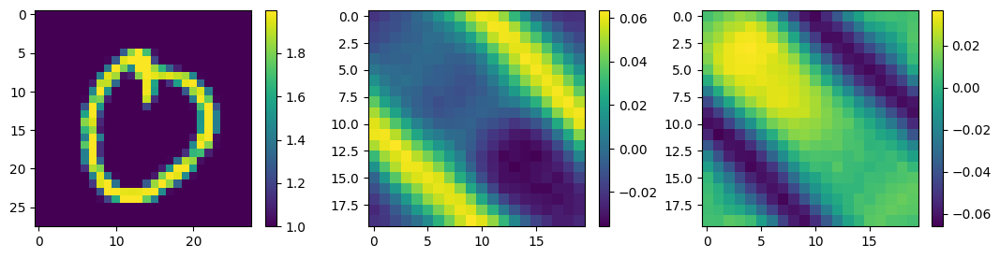
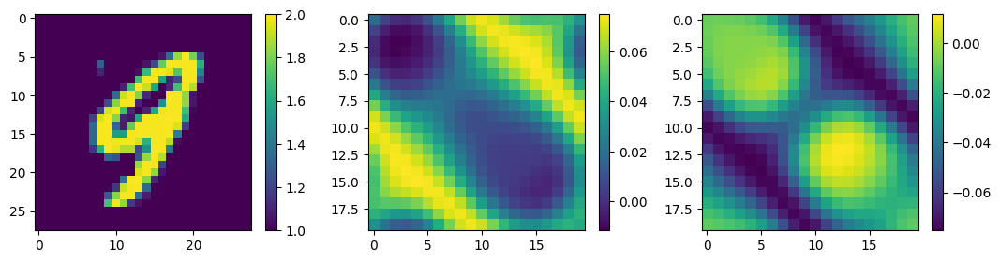
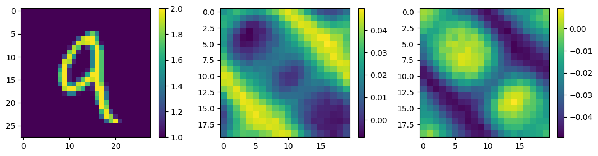
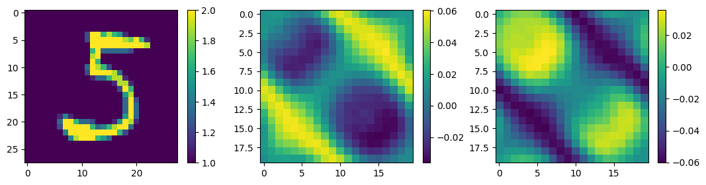
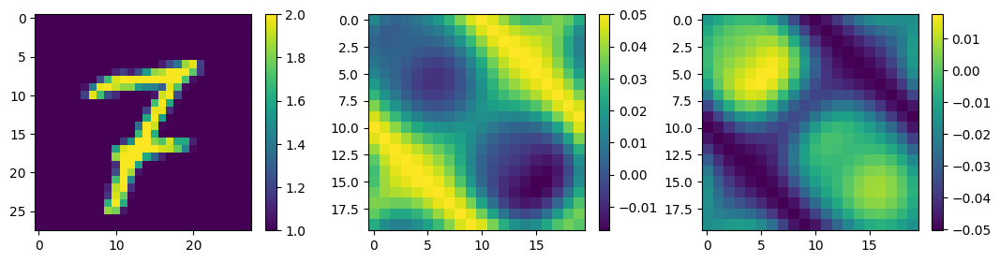
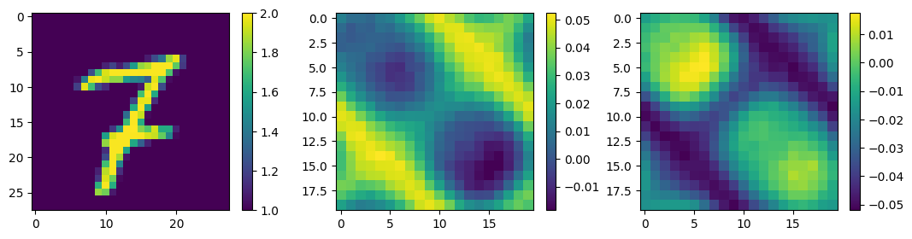

# Historical notebook: DConvNet.ipynb

Original SHA-256: `04cc1771d8d0d4278800823477b98c424d99d9240854a7bf2c5a96646b95cda1`

Code is preserved in `DConvNet.py`. Outputs below are historical evidence, not newly verified results.

### Cell 6 output 1
```text
'cuda'
```

### Cell 8 output 1
```text
AlexNet(
  (conv1): Sequential(
    (0): Conv2d(2, 50, kernel_size=(2, 2), stride=(2, 2))
    (1): ReLU()
  )
  (conv2): Sequential(
    (0): Conv2d(50, 100, kernel_size=(2, 2), stride=(1, 1), padding=same)
    (1): ReLU()
  )
  (fc1): Linear(in_features=19600, out_features=19600, bias=True)
  (fc2): Linear(in_features=19600, out_features=800, bias=True)
)
```

### Cell 9 output 1
```text
Downloading helper_functions.py script

```

### Cell 12 output 1
```text
  0%|          | 0/200 [00:00<?, ?it/s]
```

### Cell 12 output 2
```text
Epoch: 0

```

### Cell 12 output 3
```text
/usr/local/lib/python3.10/dist-packages/torch/nn/modules/conv.py:459: UserWarning: Using padding='same' with even kernel lengths and odd dilation may require a zero-padded copy of the input be created (Triggered internally at ../aten/src/ATen/native/Convolution.cpp:1003.)
  return F.conv2d(input, weight, bias, self.stride,

```

### Cell 12 output 4
```text
Train loss: 0.0005894946 | Test loss: 0.0002816683 | Accuracy: 10511.2539062500

Epoch: 1
Train loss: 0.0002220904 | Test loss: 0.0001978949 | Accuracy: 8726.8964843750

Epoch: 2
Train loss: 0.0001548083 | Test loss: 0.0001418613 | Accuracy: 7344.3408203125

Epoch: 3
Train loss: 0.0001119294 | Test loss: 0.0001055732 | Accuracy: 6315.0429687500

Epoch: 4
Train loss: 0.0000845022 | Test loss: 0.0000814757 | Accuracy: 5541.4316406250

Epoch: 5
Train loss: 0.0000662345 | Test loss: 0.0000647706 | Accuracy: 4942.8320312500

Epoch: 6
Train loss: 0.0000534415 | Test loss: 0.0000527297 | Accuracy: 4466.6313476562

Epoch: 7
Train loss: 0.0000441408 | Test loss: 0.0000438249 | Accuracy: 4080.5573730469

Epoch: 8
Train loss: 0.0000372202 | Test loss: 0.0000371708 | Accuracy: 3765.8984375000

Epoch: 9
Train loss: 0.0000319849 | Test loss: 0.0000321520 | Accuracy: 3508.7204589844

Epoch: 10
Train loss: 0.0000279684 | Test loss: 0.0000283074 | Accuracy: 3296.8378906250

Epoch: 11
Train loss: 0.0000248396 | Test loss: 0.0000253067 | Accuracy: 3120.3957519531

Epoch: 12
Train loss: 0.0000223593 | Test loss: 0.0000229200 | Accuracy: 2971.8808593750

Epoch: 13
Train loss: 0.0000203577 | Test loss: 0.0000209887 | Accuracy: 2845.5144042969

Epoch: 14
Train loss: 0.0000187141 | Test loss: 0.0000193954 | Accuracy: 2736.5034179688

Epoch: 15
Train loss: 0.0000173410 | Test loss: 0.0000180547 | Accuracy: 2641.1621093750

Epoch: 16
Train loss: 0.0000161754 | Test loss: 0.0000169075 | Accuracy: 2556.7099609375

Epoch: 17
Train loss: 0.0000151719 | Test loss: 0.0000159146 | Accuracy: 2481.2839355469

Epoch: 18
Train loss: 0.0000142970 | Test loss: 0.0000150472 | Accuracy: 2413.4335937500

Epoch: 19
Train loss: 0.0000135254 | Test loss: 0.0000142817 | Accuracy: 2351.8642578125

Epoch: 20
Train loss: 0.0000128381 | Test loss: 0.0000135995 | Accuracy: 2295.5437011719

Epoch: 21
Train loss: 0.0000122208 | Test loss: 0.0000129869 | Accuracy: 2243.7062988281

Epoch: 22
Train loss: 0.0000116628 | Test loss: 0.0000124325 | Accuracy: 2195.7033691406

Epoch: 23
Train loss: 0.0000111556 | Test loss: 0.0000119271 | Accuracy: 2150.9306640625

Epoch: 24
Train loss: 0.0000106924 | Test loss: 0.0000114636 | Accuracy: 2108.9570312500

Epoch: 25
Train loss: 0.0000102676 | Test loss: 0.0000110372 | Accuracy: 2069.5605468750

Epoch: 26
Train loss: 0.0000098764 | Test loss: 0.0000106435 | Accuracy: 2032.4440917969

Epoch: 27
Train loss: 0.0000095145 | Test loss: 0.0000102783 | Accuracy: 1997.4188232422

Epoch: 28
Train loss: 0.0000091780 | Test loss: 0.0000099383 | Accuracy: 1964.2343750000

Epoch: 29
Train loss: 0.0000088640 | Test loss: 0.0000096206 | Accuracy: 1932.7067871094

Epoch: 30
Train loss: 0.0000085701 | Test loss: 0.0000093231 | Accuracy: 1902.7192382812

Epoch: 31
Train loss: 0.0000082943 | Test loss: 0.0000090440 | Accuracy: 1874.1424560547

Epoch: 32
Train loss: 0.0000080350 | Test loss: 0.0000087816 | Accuracy: 1846.8491210938

Epoch: 33
Train loss: 0.0000077906 | Test loss: 0.0000085343 | Accuracy: 1820.7539062500

Epoch: 34
Train loss: 0.0000075599 | Test loss: 0.0000083011 | Accuracy: 1795.7747802734

Epoch: 35
Train loss: 0.0000073416 | Test loss: 0.0000080802 | Accuracy: 1771.8062744141

Epoch: 36
Train loss: 0.0000071347 | Test loss: 0.0000078696 | Accuracy: 1748.6611328125

Epoch: 37
Train loss: 0.0000069382 | Test loss: 0.0000076678 | Accuracy: 1726.1564941406

Epoch: 38
Train loss: 0.0000067512 | Test loss: 0.0000074740 | Accuracy: 1704.2534179688

Epoch: 39
Train loss: 0.0000065731 | Test loss: 0.0000072881 | Accuracy: 1682.9757080078

Epoch: 40
Train loss: 0.0000064033 | Test loss: 0.0000071104 | Accuracy: 1662.3604736328

Epoch: 41
Train loss: 0.0000062414 | Test loss: 0.0000069406 | Accuracy: 1642.4082031250

Epoch: 42
Train loss: 0.0000060867 | Test loss: 0.0000067782 | Accuracy: 1623.0869140625

Epoch: 43
Train loss: 0.0000059390 | Test loss: 0.0000066226 | Accuracy: 1604.3538818359

Epoch: 44
Train loss: 0.0000057977 | Test loss: 0.0000064737 | Accuracy: 1586.2207031250

Epoch: 45
Train loss: 0.0000056626 | Test loss: 0.0000063314 | Accuracy: 1568.6737060547

Epoch: 46
Train loss: 0.0000055330 | Test loss: 0.0000061954 | Accuracy: 1551.7097167969

Epoch: 47
Train loss: 0.0000054087 | Test loss: 0.0000060656 | Accuracy: 1535.3250732422

Epoch: 48
Train loss: 0.0000052893 | Test loss: 0.0000059412 | Accuracy: 1519.4715576172

Epoch: 49
Train loss: 0.0000051744 | Test loss: 0.0000058219 | Accuracy: 1504.1147460938

Epoch: 50
Train loss: 0.0000050636 | Test loss: 0.0000057070 | Accuracy: 1489.2015380859

Epoch: 51
Train loss: 0.0000049565 | Test loss: 0.0000055959 | Accuracy: 1474.6342773438

Epoch: 52
Train loss: 0.0000048529 | Test loss: 0.0000054883 | Accuracy: 1460.3662109375

Epoch: 53
Train loss: 0.0000047526 | Test loss: 0.0000053838 | Accuracy: 1446.3826904297

Epoch: 54
Train loss: 0.0000046557 | Test loss: 0.0000052824 | Accuracy: 1432.6904296875

Epoch: 55
Train loss: 0.0000045621 | Test loss: 0.0000051841 | Accuracy: 1419.2873535156

Epoch: 56
Train loss: 0.0000044717 | Test loss: 0.0000050890 | Accuracy: 1406.1937255859

Epoch: 57
Train loss: 0.0000043844 | Test loss: 0.0000049970 | Accuracy: 1393.4044189453

Epoch: 58
Train loss: 0.0000043001 | Test loss: 0.0000049083 | Accuracy: 1380.9261474609

Epoch: 59
Train loss: 0.0000042188 | Test loss: 0.0000048229 | Accuracy: 1368.8127441406

Epoch: 60
Train loss: 0.0000041402 | Test loss: 0.0000047406 | Accuracy: 1357.0692138672

Epoch: 61
Train loss: 0.0000040642 | Test loss: 0.0000046614 | Accuracy: 1345.6784667969

Epoch: 62
Train loss: 0.0000039906 | Test loss: 0.0000045849 | Accuracy: 1334.5938720703

Epoch: 63
Train loss: 0.0000039192 | Test loss: 0.0000045107 | Accuracy: 1323.7587890625

Epoch: 64
Train loss: 0.0000038498 | Test loss: 0.0000044386 | Accuracy: 1313.1341552734

Epoch: 65
Train loss: 0.0000037823 | Test loss: 0.0000043682 | Accuracy: 1302.7016601562

Epoch: 66
Train loss: 0.0000037166 | Test loss: 0.0000042998 | Accuracy: 1292.4562988281

Epoch: 67
Train loss: 0.0000036528 | Test loss: 0.0000042333 | Accuracy: 1282.4018554688

Epoch: 68
Train loss: 0.0000035907 | Test loss: 0.0000041689 | Accuracy: 1272.5788574219

Epoch: 69
Train loss: 0.0000035303 | Test loss: 0.0000041065 | Accuracy: 1262.9957275391

Epoch: 70
Train loss: 0.0000034717 | Test loss: 0.0000040462 | Accuracy: 1253.6683349609

Epoch: 71
Train loss: 0.0000034147 | Test loss: 0.0000039879 | Accuracy: 1244.5982666016

Epoch: 72
Train loss: 0.0000033594 | Test loss: 0.0000039314 | Accuracy: 1235.7584228516

Epoch: 73
Train loss: 0.0000033056 | Test loss: 0.0000038768 | Accuracy: 1227.1391601562

Epoch: 74
Train loss: 0.0000032534 | Test loss: 0.0000038237 | Accuracy: 1218.7309570312

Epoch: 75
Train loss: 0.0000032026 | Test loss: 0.0000037720 | Accuracy: 1210.4880371094

Epoch: 76
Train loss: 0.0000031533 | Test loss: 0.0000037216 | Accuracy: 1202.3845214844

Epoch: 77
Train loss: 0.0000031053 | Test loss: 0.0000036722 | Accuracy: 1194.3948974609

Epoch: 78
Train loss: 0.0000030587 | Test loss: 0.0000036237 | Accuracy: 1186.4918212891

Epoch: 79
Train loss: 0.0000030133 | Test loss: 0.0000035759 | Accuracy: 1178.6668701172

Epoch: 80
Train loss: 0.0000029691 | Test loss: 0.0000035290 | Accuracy: 1170.9023437500

Epoch: 81
Train loss: 0.0000029260 | Test loss: 0.0000034827 | Accuracy: 1163.1905517578

Epoch: 82
Train loss: 0.0000028839 | Test loss: 0.0000034371 | Accuracy: 1155.5341796875

Epoch: 83
Train loss: 0.0000028428 | Test loss: 0.0000033921 | Accuracy: 1147.9279785156

Epoch: 84
Train loss: 0.0000028027 | Test loss: 0.0000033480 | Accuracy: 1140.3776855469

Epoch: 85
Train loss: 0.0000027634 | Test loss: 0.0000033045 | Accuracy: 1132.9000244141

Epoch: 86
Train loss: 0.0000027250 | Test loss: 0.0000032618 | Accuracy: 1125.5058593750

Epoch: 87
Train loss: 0.0000026875 | Test loss: 0.0000032199 | Accuracy: 1118.2050781250

Epoch: 88
Train loss: 0.0000026507 | Test loss: 0.0000031789 | Accuracy: 1111.0076904297

Epoch: 89
Train loss: 0.0000026147 | Test loss: 0.0000031388 | Accuracy: 1103.9300537109

Epoch: 90
Train loss: 0.0000025795 | Test loss: 0.0000030996 | Accuracy: 1096.9729003906

Epoch: 91
Train loss: 0.0000025450 | Test loss: 0.0000030614 | Accuracy: 1090.1345214844

Epoch: 92
Train loss: 0.0000025112 | Test loss: 0.0000030239 | Accuracy: 1083.4061279297

Epoch: 93
Train loss: 0.0000024781 | Test loss: 0.0000029873 | Accuracy: 1076.7944335938

Epoch: 94
Train loss: 0.0000024457 | Test loss: 0.0000029513 | Accuracy: 1070.2807617188

Epoch: 95
Train loss: 0.0000024139 | Test loss: 0.0000029162 | Accuracy: 1063.8731689453

Epoch: 96
Train loss: 0.0000023828 | Test loss: 0.0000028818 | Accuracy: 1057.5665283203

Epoch: 97
Train loss: 0.0000023524 | Test loss: 0.0000028481 | Accuracy: 1051.3547363281

Epoch: 98
Train loss: 0.0000023226 | Test loss: 0.0000028151 | Accuracy: 1045.2401123047

Epoch: 99
Train loss: 0.0000022934 | Test loss: 0.0000027829 | Accuracy: 1039.2296142578

Epoch: 100
Train loss: 0.0000022649 | Test loss: 0.0000027514 | Accuracy: 1033.3146972656

Epoch: 101
Train loss: 0.0000022370 | Test loss: 0.0000027205 | Accuracy: 1027.4923095703

Epoch: 102
Train loss: 0.0000022097 | Test loss: 0.0000026903 | Accuracy: 1021.7499389648

Epoch: 103
Train loss: 0.0000021829 | Test loss: 0.0000026607 | Accuracy: 1016.0929565430

Epoch: 104
Train loss: 0.0000021568 | Test loss: 0.0000026316 | Accuracy: 1010.5029296875

Epoch: 105
Train loss: 0.0000021311 | Test loss: 0.0000026031 | Accuracy: 1004.9849243164

Epoch: 106
Train loss: 0.0000021060 | Test loss: 0.0000025751 | Accuracy: 999.5344238281

Epoch: 107
Train loss: 0.0000020814 | Test loss: 0.0000025476 | Accuracy: 994.1394042969

Epoch: 108
Train loss: 0.0000020572 | Test loss: 0.0000025205 | Accuracy: 988.8037719727

Epoch: 109
Train loss: 0.0000020335 | Test loss: 0.0000024939 | Accuracy: 983.5239868164

Epoch: 110
Train loss: 0.0000020103 | Test loss: 0.0000024678 | Accuracy: 978.3018798828

Epoch: 111
Train loss: 0.0000019875 | Test loss: 0.0000024420 | Accuracy: 973.1386718750

Epoch: 112
Train loss: 0.0000019651 | Test loss: 0.0000024168 | Accuracy: 968.0339355469

Epoch: 113
Train loss: 0.0000019432 | Test loss: 0.0000023918 | Accuracy: 962.9694824219

Epoch: 114
Train loss: 0.0000019215 | Test loss: 0.0000023672 | Accuracy: 957.9394531250

Epoch: 115
Train loss: 0.0000019002 | Test loss: 0.0000023429 | Accuracy: 952.9709472656

Epoch: 116
Train loss: 0.0000018793 | Test loss: 0.0000023191 | Accuracy: 948.0587158203

Epoch: 117
Train loss: 0.0000018588 | Test loss: 0.0000022957 | Accuracy: 943.2023315430

Epoch: 118
Train loss: 0.0000018387 | Test loss: 0.0000022726 | Accuracy: 938.4044189453

Epoch: 119
Train loss: 0.0000018189 | Test loss: 0.0000022500 | Accuracy: 933.6670532227

Epoch: 120
Train loss: 0.0000017995 | Test loss: 0.0000022277 | Accuracy: 928.9869995117

Epoch: 121
Train loss: 0.0000017805 | Test loss: 0.0000022059 | Accuracy: 924.3639526367

Epoch: 122
Train loss: 0.0000017618 | Test loss: 0.0000021844 | Accuracy: 919.8037109375

Epoch: 123
Train loss: 0.0000017434 | Test loss: 0.0000021633 | Accuracy: 915.2984619141

Epoch: 124
Train loss: 0.0000017253 | Test loss: 0.0000021426 | Accuracy: 910.8529663086

Epoch: 125
Train loss: 0.0000017076 | Test loss: 0.0000021223 | Accuracy: 906.4702758789

Epoch: 126
Train loss: 0.0000016902 | Test loss: 0.0000021023 | Accuracy: 902.1461791992

Epoch: 127
Train loss: 0.0000016731 | Test loss: 0.0000020827 | Accuracy: 897.8744506836

Epoch: 128
Train loss: 0.0000016562 | Test loss: 0.0000020635 | Accuracy: 893.6543579102

Epoch: 129
Train loss: 0.0000016396 | Test loss: 0.0000020445 | Accuracy: 889.4887084961

Epoch: 130
Train loss: 0.0000016233 | Test loss: 0.0000020260 | Accuracy: 885.3777465820

Epoch: 131
Train loss: 0.0000016073 | Test loss: 0.0000020077 | Accuracy: 881.3201293945

Epoch: 132
Train loss: 0.0000015916 | Test loss: 0.0000019897 | Accuracy: 877.3163452148

Epoch: 133
Train loss: 0.0000015761 | Test loss: 0.0000019721 | Accuracy: 873.3609008789

Epoch: 134
Train loss: 0.0000015608 | Test loss: 0.0000019547 | Accuracy: 869.4525756836

Epoch: 135
Train loss: 0.0000015458 | Test loss: 0.0000019376 | Accuracy: 865.5955200195

Epoch: 136
Train loss: 0.0000015311 | Test loss: 0.0000019208 | Accuracy: 861.7822265625

Epoch: 137
Train loss: 0.0000015166 | Test loss: 0.0000019042 | Accuracy: 858.0112915039

Epoch: 138
Train loss: 0.0000015023 | Test loss: 0.0000018879 | Accuracy: 854.2827758789

Epoch: 139
Train loss: 0.0000014882 | Test loss: 0.0000018718 | Accuracy: 850.5930175781

Epoch: 140
Train loss: 0.0000014744 | Test loss: 0.0000018559 | Accuracy: 846.9408569336

Epoch: 141
Train loss: 0.0000014608 | Test loss: 0.0000018403 | Accuracy: 843.3282470703

Epoch: 142
Train loss: 0.0000014473 | Test loss: 0.0000018249 | Accuracy: 839.7550048828

Epoch: 143
Train loss: 0.0000014341 | Test loss: 0.0000018097 | Accuracy: 836.2243652344

Epoch: 144
Train loss: 0.0000014211 | Test loss: 0.0000017948 | Accuracy: 832.7370605469

Epoch: 145
Train loss: 0.0000014083 | Test loss: 0.0000017801 | Accuracy: 829.2834472656

Epoch: 146
Train loss: 0.0000013957 | Test loss: 0.0000017656 | Accuracy: 825.8720703125

Epoch: 147
Train loss: 0.0000013833 | Test loss: 0.0000017514 | Accuracy: 822.4984130859

Epoch: 148
Train loss: 0.0000013711 | Test loss: 0.0000017374 | Accuracy: 819.1660766602

Epoch: 149
Train loss: 0.0000013591 | Test loss: 0.0000017236 | Accuracy: 815.8764648438

Epoch: 150
Train loss: 0.0000013472 | Test loss: 0.0000017100 | Accuracy: 812.6305541992

Epoch: 151
Train loss: 0.0000013355 | Test loss: 0.0000016967 | Accuracy: 809.4252319336

Epoch: 152
Train loss: 0.0000013240 | Test loss: 0.0000016835 | Accuracy: 806.2612915039

Epoch: 153
Train loss: 0.0000013127 | Test loss: 0.0000016707 | Accuracy: 803.1434936523

Epoch: 154
Train loss: 0.0000013015 | Test loss: 0.0000016580 | Accuracy: 800.0616455078

Epoch: 155
Train loss: 0.0000012905 | Test loss: 0.0000016455 | Accuracy: 797.0178833008

Epoch: 156
Train loss: 0.0000012796 | Test loss: 0.0000016332 | Accuracy: 794.0138549805

Epoch: 157
Train loss: 0.0000012689 | Test loss: 0.0000016211 | Accuracy: 791.0460205078

Epoch: 158
Train loss: 0.0000012583 | Test loss: 0.0000016093 | Accuracy: 788.1198120117

Epoch: 159
Train loss: 0.0000012479 | Test loss: 0.0000015976 | Accuracy: 785.2276611328

Epoch: 160
Train loss: 0.0000012376 | Test loss: 0.0000015861 | Accuracy: 782.3732299805

Epoch: 161
Train loss: 0.0000012275 | Test loss: 0.0000015748 | Accuracy: 779.5504760742

Epoch: 162
Train loss: 0.0000012175 | Test loss: 0.0000015636 | Accuracy: 776.7587890625

Epoch: 163
Train loss: 0.0000012077 | Test loss: 0.0000015526 | Accuracy: 774.0050048828

Epoch: 164
Train loss: 0.0000011979 | Test loss: 0.0000015418 | Accuracy: 771.2760009766

Epoch: 165
Train loss: 0.0000011883 | Test loss: 0.0000015311 | Accuracy: 768.5716552734

Epoch: 166
Train loss: 0.0000011789 | Test loss: 0.0000015205 | Accuracy: 765.8961181641

Epoch: 167
Train loss: 0.0000011695 | Test loss: 0.0000015101 | Accuracy: 763.2453002930

Epoch: 168
Train loss: 0.0000011603 | Test loss: 0.0000014998 | Accuracy: 760.6193847656

Epoch: 169
Train loss: 0.0000011512 | Test loss: 0.0000014896 | Accuracy: 758.0193481445

Epoch: 170
Train loss: 0.0000011422 | Test loss: 0.0000014796 | Accuracy: 755.4394531250

Epoch: 171
Train loss: 0.0000011334 | Test loss: 0.0000014697 | Accuracy: 752.8868408203

Epoch: 172
Train loss: 0.0000011246 | Test loss: 0.0000014599 | Accuracy: 750.3513183594

Epoch: 173
Train loss: 0.0000011160 | Test loss: 0.0000014502 | Accuracy: 747.8375244141

Epoch: 174
Train loss: 0.0000011075 | Test loss: 0.0000014406 | Accuracy: 745.3416137695

Epoch: 175
Train loss: 0.0000010991 | Test loss: 0.0000014311 | Accuracy: 742.8644409180

Epoch: 176
Train loss: 0.0000010907 | Test loss: 0.0000014217 | Accuracy: 740.4020996094

Epoch: 177
Train loss: 0.0000010825 | Test loss: 0.0000014124 | Accuracy: 737.9545898438

Epoch: 178
Train loss: 0.0000010744 | Test loss: 0.0000014031 | Accuracy: 735.5192260742

Epoch: 179
Train loss: 0.0000010664 | Test loss: 0.0000013940 | Accuracy: 733.0932006836

Epoch: 180
Train loss: 0.0000010585 | Test loss: 0.0000013849 | Accuracy: 730.6831665039

Epoch: 181
Train loss: 0.0000010507 | Test loss: 0.0000013759 | Accuracy: 728.2858276367

Epoch: 182
Train loss: 0.0000010430 | Test loss: 0.0000013670 | Accuracy: 725.9096069336

Epoch: 183
Train loss: 0.0000010353 | Test loss: 0.0000013583 | Accuracy: 723.5524902344

Epoch: 184
Train loss: 0.0000010278 | Test loss: 0.0000013496 | Accuracy: 721.2079467773

Epoch: 185
Train loss: 0.0000010204 | Test loss: 0.0000013410 | Accuracy: 718.8845214844

Epoch: 186
Train loss: 0.0000010130 | Test loss: 0.0000013325 | Accuracy: 716.5782470703

Epoch: 187
Train loss: 0.0000010058 | Test loss: 0.0000013241 | Accuracy: 714.2859497070

Epoch: 188
Train loss: 0.0000009986 | Test loss: 0.0000013157 | Accuracy: 712.0028076172

Epoch: 189
Train loss: 0.0000009915 | Test loss: 0.0000013073 | Accuracy: 709.6854858398

Epoch: 190
Train loss: 0.0000009844 | Test loss: 0.0000012989 | Accuracy: 707.3746948242

Epoch: 191
Train loss: 0.0000009775 | Test loss: 0.0000012906 | Accuracy: 705.0911865234

Epoch: 192
Train loss: 0.0000009706 | Test loss: 0.0000012825 | Accuracy: 702.8408203125

Epoch: 193
Train loss: 0.0000009638 | Test loss: 0.0000012745 | Accuracy: 700.6159667969

Epoch: 194
Train loss: 0.0000009571 | Test loss: 0.0000012666 | Accuracy: 698.4100952148

Epoch: 195
Train loss: 0.0000009505 | Test loss: 0.0000012587 | Accuracy: 696.1877441406

Epoch: 196
Train loss: 0.0000009439 | Test loss: 0.0000012509 | Accuracy: 693.9851684570

Epoch: 197
Train loss: 0.0000009375 | Test loss: 0.0000012431 | Accuracy: 691.8082275391

Epoch: 198
Train loss: 0.0000009311 | Test loss: 0.0000012355 | Accuracy: 689.6502685547

Epoch: 199
Train loss: 0.0000009248 | Test loss: 0.0000012280 | Accuracy: 687.5229492188


Train time on cuda:0: 2103.450 seconds

```

### Cell 13 output 1
```text
saveing checkpoint

```

### Cell 14 output 1
```text
<Figure size 1300x300 with 6 Axes>
```


### Cell 14 output 2
```text
<Figure size 1300x300 with 6 Axes>
```



### Cell 14 output 3
```text
accuracy is:  tensor(68.4667)


```

### Cell 14 output 4
```text
<Figure size 1300x300 with 6 Axes>
```



### Cell 14 output 5
```text
<Figure size 1300x300 with 6 Axes>
```


### Cell 14 output 6
```text
accuracy is:  tensor(68.4667)


```

### Cell 14 output 7
```text
<Figure size 1300x300 with 6 Axes>
```


### Cell 14 output 8
```text
<Figure size 1300x300 with 6 Axes>
```



### Cell 14 output 9
```text
accuracy is:  tensor(68.4667)


```

### Cell 14 output 10
```text
<Figure size 1300x300 with 6 Axes>
```


### Cell 14 output 11
```text
<Figure size 1300x300 with 6 Axes>
```



### Cell 14 output 12
```text
accuracy is:  tensor(68.4667)


```

### Cell 14 output 13
```text
<Figure size 1300x300 with 6 Axes>
```



### Cell 14 output 14
```text
<Figure size 1300x300 with 6 Axes>
```



### Cell 14 output 15
```text
accuracy is:  tensor(68.4667)


```
