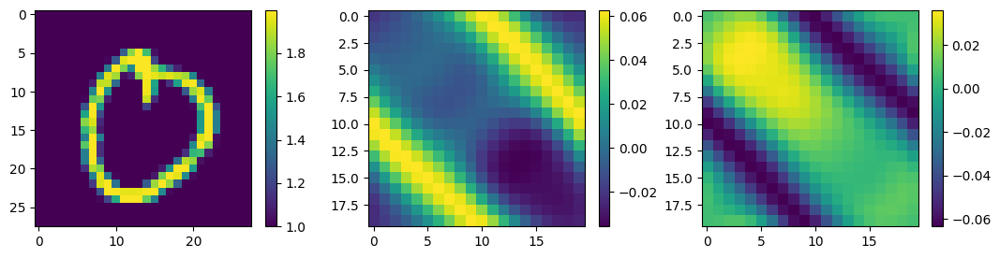
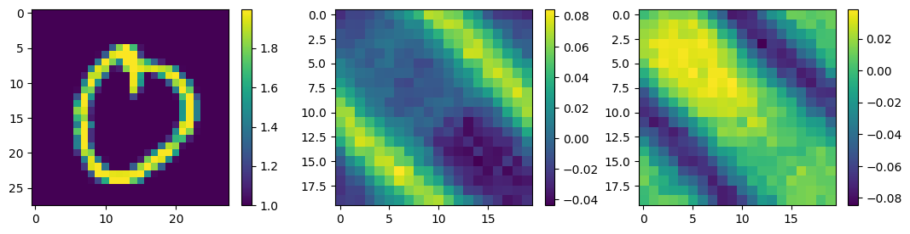

# Historical notebook: DConvNet_FullData.ipynb

Original SHA-256: `32cf99fed167d903f08c8f7f82d9ccb37642f6e4ec239b7ad5338ff7d759e73e`

Code is preserved in `DConvNet_FullData.py`. Outputs below are historical evidence, not newly verified results.

### Cell 6 output 1
```text
'cuda'
```

### Cell 8 output 1
```text
AlexNet(
  (conv1): Sequential(
    (0): Conv2d(2, 50, kernel_size=(2, 2), stride=(2, 2))
    (1): ReLU()
  )
  (conv2): Sequential(
    (0): Conv2d(50, 100, kernel_size=(2, 2), stride=(1, 1), padding=same)
    (1): ReLU()
  )
  (fc1): Linear(in_features=19600, out_features=19600, bias=True)
  (fc2): Linear(in_features=19600, out_features=800, bias=True)
)
```

### Cell 9 output 1
```text
Python script already downloaded

```

### Cell 12 output 1
```text
  0%|          | 0/400 [00:00<?, ?it/s]
```

### Cell 12 output 2
```text
Epoch: 0

```

### Cell 12 output 3
```text
/usr/local/lib/python3.10/dist-packages/torch/nn/modules/conv.py:459: UserWarning: Using padding='same' with even kernel lengths and odd dilation may require a zero-padded copy of the input be created (Triggered internally at ../aten/src/ATen/native/Convolution.cpp:1003.)
  return F.conv2d(input, weight, bias, self.stride,

```

### Cell 12 output 4
```text
Better
Train loss: 0.0032710859 | Test loss: 0.0243039150 | Accuracy: 108529.8593750000 | MSEmax: 0.0263278205

Epoch: 1
Train loss: 0.0243261997 | Test loss: 0.0042186822 | Accuracy: 39739.6328125000 | MSEmax: 0.0050177616

Epoch: 2
Train loss: 0.0042372900 | Test loss: 0.0030945891 | Accuracy: 36225.4257812500 | MSEmax: 0.0073458548

Epoch: 3
Better
Train loss: 0.0029960044 | Test loss: 0.0058785961 | Accuracy: 45831.8359375000 | MSEmax: 0.0123975994

Epoch: 4
Train loss: 0.0057089617 | Test loss: 0.0056323302 | Accuracy: 41836.1953125000 | MSEmax: 0.0117828026

Epoch: 5
Train loss: 0.0054723481 | Test loss: 0.0031152281 | Accuracy: 31501.0839843750 | MSEmax: 0.0073949085

Epoch: 6
Train loss: 0.0030114504 | Test loss: 0.0009932528 | Accuracy: 19137.5000000000 | MSEmax: 0.0032143584

Epoch: 7
Better
Train loss: 0.0009531799 | Test loss: 0.0008590533 | Accuracy: 17891.8925781250 | MSEmax: 0.0017173119

Epoch: 8
Better
Train loss: 0.0008653021 | Test loss: 0.0022064510 | Accuracy: 26597.3515625000 | MSEmax: 0.0029603271

Epoch: 9
Train loss: 0.0022324608 | Test loss: 0.0029307653 | Accuracy: 29173.5703125000 | MSEmax: 0.0036748671

Epoch: 10
Train loss: 0.0029571096 | Test loss: 0.0022358529 | Accuracy: 25047.0117187500 | MSEmax: 0.0028886138

Epoch: 11
Train loss: 0.0022554044 | Test loss: 0.0010670032 | Accuracy: 18177.2480468750 | MSEmax: 0.0017096150

Epoch: 12
Train loss: 0.0010758740 | Test loss: 0.0003894061 | Accuracy: 12354.0556640625 | MSEmax: 0.0013989535

Epoch: 13
Better
Train loss: 0.0003830456 | Test loss: 0.0004104495 | Accuracy: 12415.4150390625 | MSEmax: 0.0019670955

Epoch: 14
Train loss: 0.0003854505 | Test loss: 0.0007732706 | Accuracy: 15516.1845703125 | MSEmax: 0.0028844858

Epoch: 15
Train loss: 0.0007298274 | Test loss: 0.0010831108 | Accuracy: 17772.7890625000 | MSEmax: 0.0036150720

Epoch: 16
Train loss: 0.0010254693 | Test loss: 0.0011866491 | Accuracy: 19084.0507812500 | MSEmax: 0.0039144754

Epoch: 17
Train loss: 0.0011218060 | Test loss: 0.0010972144 | Accuracy: 18943.9941406250 | MSEmax: 0.0037677838

Epoch: 18
Train loss: 0.0010331398 | Test loss: 0.0008753171 | Accuracy: 17212.6660156250 | MSEmax: 0.0032701325

Epoch: 19
Train loss: 0.0008190364 | Test loss: 0.0005969221 | Accuracy: 14402.0517578125 | MSEmax: 0.0025793985

Epoch: 20
Train loss: 0.0005529501 | Test loss: 0.0003536051 | Accuracy: 11354.7539062500 | MSEmax: 0.0018845754

Epoch: 21
Better
Train loss: 0.0003233655 | Test loss: 0.0002249903 | Accuracy: 9294.6250000000 | MSEmax: 0.0013448941

Epoch: 22
Better
Train loss: 0.0002073205 | Test loss: 0.0002305698 | Accuracy: 9514.7431640625 | MSEmax: 0.0010230215

Epoch: 23
Train loss: 0.0002228448 | Test loss: 0.0003196161 | Accuracy: 10998.6044921875 | MSEmax: 0.0008852105

Epoch: 24
Train loss: 0.0003187509 | Test loss: 0.0004100427 | Accuracy: 12175.9736328125 | MSEmax: 0.0008415820

Epoch: 25
Train loss: 0.0004130450 | Test loss: 0.0004424636 | Accuracy: 12426.1660156250 | MSEmax: 0.0008287452

Epoch: 26
Train loss: 0.0004467099 | Test loss: 0.0004125652 | Accuracy: 11872.6669921875 | MSEmax: 0.0008143446

Epoch: 27
Train loss: 0.0004159611 | Test loss: 0.0003517498 | Accuracy: 11020.3437500000 | MSEmax: 0.0007996046

Epoch: 28
Train loss: 0.0003527947 | Test loss: 0.0002876859 | Accuracy: 10202.3837890625 | MSEmax: 0.0008002208

Epoch: 29
Train loss: 0.0002854170 | Test loss: 0.0002308881 | Accuracy: 9371.0683593750 | MSEmax: 0.0008322234

Epoch: 30
Train loss: 0.0002247411 | Test loss: 0.0001849986 | Accuracy: 8470.7070312500 | MSEmax: 0.0008893560

Epoch: 31
Better
Train loss: 0.0001747553 | Test loss: 0.0001592625 | Accuracy: 7790.0908203125 | MSEmax: 0.0009669696

Epoch: 32
Better
Train loss: 0.0001451072 | Test loss: 0.0001622562 | Accuracy: 7739.3994140625 | MSEmax: 0.0010584714

Epoch: 33
Better
Train loss: 0.0001448011 | Test loss: 0.0001865646 | Accuracy: 8205.4511718750 | MSEmax: 0.0011460814

Epoch: 34
Train loss: 0.0001667054 | Test loss: 0.0002129841 | Accuracy: 8693.8701171875 | MSEmax: 0.0012085917

Epoch: 35
Train loss: 0.0001915725 | Test loss: 0.0002271408 | Accuracy: 8917.0859375000 | MSEmax: 0.0012383753

Epoch: 36
Train loss: 0.0002047352 | Test loss: 0.0002266544 | Accuracy: 8853.2666015625 | MSEmax: 0.0012402176

Epoch: 37
Train loss: 0.0002036088 | Test loss: 0.0002163750 | Accuracy: 8617.5175781250 | MSEmax: 0.0012188419

Epoch: 38
Train loss: 0.0001931569 | Test loss: 0.0002006470 | Accuracy: 8303.5878906250 | MSEmax: 0.0011722029

Epoch: 39
Train loss: 0.0001780267 | Test loss: 0.0001814622 | Accuracy: 7943.1489257812 | MSEmax: 0.0010974988

Epoch: 40
Train loss: 0.0001603669 | Test loss: 0.0001600358 | Accuracy: 7530.2104492188 | MSEmax: 0.0009981734

Epoch: 41
Better
Train loss: 0.0001412332 | Test loss: 0.0001382146 | Accuracy: 7068.3442382812 | MSEmax: 0.0008912584

Epoch: 42
Better
Train loss: 0.0001221265 | Test loss: 0.0001202036 | Accuracy: 6657.9902343750 | MSEmax: 0.0007864235

Epoch: 43
Better
Train loss: 0.0001069206 | Test loss: 0.0001102245 | Accuracy: 6438.1835937500 | MSEmax: 0.0006980214

Epoch: 44
Better
Train loss: 0.0000996032 | Test loss: 0.0001085776 | Accuracy: 6434.2172851562 | MSEmax: 0.0006261186

Epoch: 45
Train loss: 0.0001002900 | Test loss: 0.0001115692 | Accuracy: 6537.0869140625 | MSEmax: 0.0005721097

Epoch: 46
Train loss: 0.0001051119 | Test loss: 0.0001145059 | Accuracy: 6606.1679687500 | MSEmax: 0.0005346240

Epoch: 47
Train loss: 0.0001092739 | Test loss: 0.0001151272 | Accuracy: 6592.4458007812 | MSEmax: 0.0005109176

Epoch: 48
Train loss: 0.0001105500 | Test loss: 0.0001136514 | Accuracy: 6528.5356445312 | MSEmax: 0.0004979931

Epoch: 49
Train loss: 0.0001092825 | Test loss: 0.0001109382 | Accuracy: 6450.7221679688 | MSEmax: 0.0004938164

Epoch: 50
Train loss: 0.0001064331 | Test loss: 0.0001070186 | Accuracy: 6349.8071289062 | MSEmax: 0.0004966296

Epoch: 51
Train loss: 0.0001020836 | Test loss: 0.0001010689 | Accuracy: 6181.2241210938 | MSEmax: 0.0005030987

Epoch: 52
Better
Train loss: 0.0000954829 | Test loss: 0.0000938856 | Accuracy: 5957.0732421875 | MSEmax: 0.0005103681

Epoch: 53
Better
Train loss: 0.0000875503 | Test loss: 0.0000880889 | Accuracy: 5761.6450195312 | MSEmax: 0.0005185386

Epoch: 54
Better
Train loss: 0.0000810106 | Test loss: 0.0000853706 | Accuracy: 5657.7915039062 | MSEmax: 0.0005296336

Epoch: 55
Better
Train loss: 0.0000775761 | Test loss: 0.0000850758 | Accuracy: 5624.3125000000 | MSEmax: 0.0005446300

Epoch: 56
Better
Train loss: 0.0000765583 | Test loss: 0.0000855514 | Accuracy: 5607.2587890625 | MSEmax: 0.0005615510

Epoch: 57
Better
Train loss: 0.0000763070 | Test loss: 0.0000859028 | Accuracy: 5581.3427734375 | MSEmax: 0.0005763532

Epoch: 58
Better
Train loss: 0.0000760016 | Test loss: 0.0000860865 | Accuracy: 5553.3461914062 | MSEmax: 0.0005855492

Epoch: 59
Better
Train loss: 0.0000756897 | Test loss: 0.0000862155 | Accuracy: 5536.5649414062 | MSEmax: 0.0005880517

Epoch: 60
Better
Train loss: 0.0000755338 | Test loss: 0.0000857529 | Accuracy: 5514.9150390625 | MSEmax: 0.0005837870

Epoch: 61
Better
Train loss: 0.0000750185 | Test loss: 0.0000839225 | Accuracy: 5458.0273437500 | MSEmax: 0.0005721281

Epoch: 62
Better
Train loss: 0.0000733952 | Test loss: 0.0000807294 | Accuracy: 5361.2089843750 | MSEmax: 0.0005528457

Epoch: 63
Better
Train loss: 0.0000706784 | Test loss: 0.0000770095 | Accuracy: 5251.2084960938 | MSEmax: 0.0005277935

Epoch: 64
Better
Train loss: 0.0000676427 | Test loss: 0.0000736358 | Accuracy: 5156.6562500000 | MSEmax: 0.0005004581

Epoch: 65
Better
Train loss: 0.0000650405 | Test loss: 0.0000708419 | Accuracy: 5081.1508789062 | MSEmax: 0.0004735519

Epoch: 66
Better
Train loss: 0.0000630024 | Test loss: 0.0000684953 | Accuracy: 5016.9560546875 | MSEmax: 0.0004481240

Epoch: 67
Better
Train loss: 0.0000613556 | Test loss: 0.0000664995 | Accuracy: 4958.3022460938 | MSEmax: 0.0004247729

Epoch: 68
Better
Train loss: 0.0000599921 | Test loss: 0.0000650048 | Accuracy: 4911.0014648438 | MSEmax: 0.0004049807

Epoch: 69
Better
Train loss: 0.0000590323 | Test loss: 0.0000640891 | Accuracy: 4880.6787109375 | MSEmax: 0.0003899234

Epoch: 70
Better
Train loss: 0.0000585218 | Test loss: 0.0000634505 | Accuracy: 4857.2338867188 | MSEmax: 0.0003785882

Epoch: 71
Better
Train loss: 0.0000581716 | Test loss: 0.0000626283 | Accuracy: 4825.0541992188 | MSEmax: 0.0003687329

Epoch: 72
Better
Train loss: 0.0000575661 | Test loss: 0.0000614010 | Accuracy: 4776.5722656250 | MSEmax: 0.0003594353

Epoch: 73
Better
Train loss: 0.0000565008 | Test loss: 0.0000599946 | Accuracy: 4720.3906250000 | MSEmax: 0.0003521097

Epoch: 74
Better
Train loss: 0.0000551710 | Test loss: 0.0000587011 | Accuracy: 4666.9638671875 | MSEmax: 0.0003483431

Epoch: 75
Better
Train loss: 0.0000538367 | Test loss: 0.0000575506 | Accuracy: 4616.5986328125 | MSEmax: 0.0003478380

Epoch: 76
Better
Train loss: 0.0000525385 | Test loss: 0.0000564666 | Accuracy: 4564.9213867188 | MSEmax: 0.0003493175

Epoch: 77
Better
Train loss: 0.0000512363 | Test loss: 0.0000555014 | Accuracy: 4514.4116210938 | MSEmax: 0.0003519411

Epoch: 78
Better
Train loss: 0.0000500146 | Test loss: 0.0000547638 | Accuracy: 4470.7578125000 | MSEmax: 0.0003551070

Epoch: 79
Better
Train loss: 0.0000490139 | Test loss: 0.0000542778 | Accuracy: 4438.0585937500 | MSEmax: 0.0003575764

Epoch: 80
Better
Train loss: 0.0000483028 | Test loss: 0.0000538395 | Accuracy: 4409.3989257812 | MSEmax: 0.0003580332

Epoch: 81
Better
Train loss: 0.0000477162 | Test loss: 0.0000532386 | Accuracy: 4376.1328125000 | MSEmax: 0.0003561183

Epoch: 82
Better
Train loss: 0.0000470519 | Test loss: 0.0000524901 | Accuracy: 4339.3803710938 | MSEmax: 0.0003522350

Epoch: 83
Better
Train loss: 0.0000463146 | Test loss: 0.0000516686 | Accuracy: 4302.9487304688 | MSEmax: 0.0003466021

Epoch: 84
Better
Train loss: 0.0000455722 | Test loss: 0.0000507490 | Accuracy: 4265.4023437500 | MSEmax: 0.0003392362

Epoch: 85
Better
Train loss: 0.0000447935 | Test loss: 0.0000497130 | Accuracy: 4224.6118164062 | MSEmax: 0.0003305713

Epoch: 86
Better
Train loss: 0.0000439403 | Test loss: 0.0000486106 | Accuracy: 4181.7094726562 | MSEmax: 0.0003212525

Epoch: 87
Better
Train loss: 0.0000430408 | Test loss: 0.0000475275 | Accuracy: 4139.8203125000 | MSEmax: 0.0003115098

Epoch: 88
Better
Train loss: 0.0000421748 | Test loss: 0.0000465300 | Accuracy: 4101.7338867188 | MSEmax: 0.0003014529

Epoch: 89
Better
Train loss: 0.0000414071 | Test loss: 0.0000456238 | Accuracy: 4067.0888671875 | MSEmax: 0.0002914800

Epoch: 90
Better
Train loss: 0.0000407303 | Test loss: 0.0000447784 | Accuracy: 4033.6308593750 | MSEmax: 0.0002820414

Epoch: 91
Better
Train loss: 0.0000400968 | Test loss: 0.0000439750 | Accuracy: 4000.3073730469 | MSEmax: 0.0002732576

Epoch: 92
Better
Train loss: 0.0000394826 | Test loss: 0.0000432222 | Accuracy: 3968.0263671875 | MSEmax: 0.0002652269

Epoch: 93
Better
Train loss: 0.0000388952 | Test loss: 0.0000425262 | Accuracy: 3936.9357910156 | MSEmax: 0.0002583194

Epoch: 94
Better
Train loss: 0.0000383252 | Test loss: 0.0000418582 | Accuracy: 3905.4316406250 | MSEmax: 0.0002527670

Epoch: 95
Better
Train loss: 0.0000377337 | Test loss: 0.0000411948 | Accuracy: 3872.4326171875 | MSEmax: 0.0002484560

Epoch: 96
Better
Train loss: 0.0000370984 | Test loss: 0.0000405680 | Accuracy: 3839.8395996094 | MSEmax: 0.0002453244

Epoch: 97
Better
Train loss: 0.0000364563 | Test loss: 0.0000400014 | Accuracy: 3809.1125488281 | MSEmax: 0.0002432123

Epoch: 98
Better
Train loss: 0.0000358448 | Test loss: 0.0000394740 | Accuracy: 3779.5871582031 | MSEmax: 0.0002414953

Epoch: 99
Better
Train loss: 0.0000352663 | Test loss: 0.0000389553 | Accuracy: 3750.2631835938 | MSEmax: 0.0002400091

Epoch: 100
Better
Train loss: 0.0000347097 | Test loss: 0.0000384444 | Accuracy: 3721.5747070312 | MSEmax: 0.0002380915

Epoch: 101
Better
Train loss: 0.0000341794 | Test loss: 0.0000379639 | Accuracy: 3694.5761718750 | MSEmax: 0.0002361141

Epoch: 102
Better
Train loss: 0.0000336836 | Test loss: 0.0000374969 | Accuracy: 3668.6611328125 | MSEmax: 0.0002339054

Epoch: 103
Better
Train loss: 0.0000332108 | Test loss: 0.0000370018 | Accuracy: 3642.2817382812 | MSEmax: 0.0002308467

Epoch: 104
Better
Train loss: 0.0000327361 | Test loss: 0.0000364714 | Accuracy: 3615.2414550781 | MSEmax: 0.0002270855

Epoch: 105
Better
Train loss: 0.0000322504 | Test loss: 0.0000359257 | Accuracy: 3588.4091796875 | MSEmax: 0.0002229940

Epoch: 106
Better
Train loss: 0.0000317659 | Test loss: 0.0000353696 | Accuracy: 3561.8435058594 | MSEmax: 0.0002184215

Epoch: 107
Better
Train loss: 0.0000312910 | Test loss: 0.0000348017 | Accuracy: 3535.1865234375 | MSEmax: 0.0002132535

Epoch: 108
Better
Train loss: 0.0000308241 | Test loss: 0.0000342363 | Accuracy: 3508.7751464844 | MSEmax: 0.0002078669

Epoch: 109
Better
Train loss: 0.0000303665 | Test loss: 0.0000336921 | Accuracy: 3483.2958984375 | MSEmax: 0.0002026038

Epoch: 110
Better
Train loss: 0.0000299278 | Test loss: 0.0000331755 | Accuracy: 3458.9174804688 | MSEmax: 0.0001975789

Epoch: 111
Better
Train loss: 0.0000295128 | Test loss: 0.0000326841 | Accuracy: 3435.1765136719 | MSEmax: 0.0001930011

Epoch: 112
Better
Train loss: 0.0000291125 | Test loss: 0.0000322166 | Accuracy: 3411.6865234375 | MSEmax: 0.0001890680

Epoch: 113
Better
Train loss: 0.0000287171 | Test loss: 0.0000317748 | Accuracy: 3388.6396484375 | MSEmax: 0.0001857591

Epoch: 114
Better
Train loss: 0.0000283260 | Test loss: 0.0000313577 | Accuracy: 3366.1469726562 | MSEmax: 0.0001829816

Epoch: 115
Better
Train loss: 0.0000279413 | Test loss: 0.0000309567 | Accuracy: 3343.8845214844 | MSEmax: 0.0001806325

Epoch: 116
Better
Train loss: 0.0000275604 | Test loss: 0.0000305650 | Accuracy: 3321.6477050781 | MSEmax: 0.0001786247

Epoch: 117
Better
Train loss: 0.0000271824 | Test loss: 0.0000301854 | Accuracy: 3299.7055664062 | MSEmax: 0.0001768561

Epoch: 118
Better
Train loss: 0.0000268116 | Test loss: 0.0000298240 | Accuracy: 3278.4743652344 | MSEmax: 0.0001753163

Epoch: 119
Better
Train loss: 0.0000264536 | Test loss: 0.0000294752 | Accuracy: 3257.8132324219 | MSEmax: 0.0001737719

Epoch: 120
Better
Train loss: 0.0000261080 | Test loss: 0.0000291306 | Accuracy: 3237.3847656250 | MSEmax: 0.0001721230

Epoch: 121
Better
Train loss: 0.0000257707 | Test loss: 0.0000287890 | Accuracy: 3217.2492675781 | MSEmax: 0.0001704999

Epoch: 122
Better
Train loss: 0.0000254403 | Test loss: 0.0000284455 | Accuracy: 3197.3886718750 | MSEmax: 0.0001686321

Epoch: 123
Better
Train loss: 0.0000251175 | Test loss: 0.0000280923 | Accuracy: 3177.5742187500 | MSEmax: 0.0001663796

Epoch: 124
Better
Train loss: 0.0000247994 | Test loss: 0.0000277321 | Accuracy: 3157.8410644531 | MSEmax: 0.0001639066

Epoch: 125
Better
Train loss: 0.0000244836 | Test loss: 0.0000273687 | Accuracy: 3138.2663574219 | MSEmax: 0.0001612320

Epoch: 126
Better
Train loss: 0.0000241723 | Test loss: 0.0000270060 | Accuracy: 3118.9204101562 | MSEmax: 0.0001583531

Epoch: 127
Better
Train loss: 0.0000238684 | Test loss: 0.0000266511 | Accuracy: 3099.9233398438 | MSEmax: 0.0001555269

Epoch: 128
Better
Train loss: 0.0000235721 | Test loss: 0.0000263072 | Accuracy: 3081.2651367188 | MSEmax: 0.0001528685

Epoch: 129
Better
Train loss: 0.0000232826 | Test loss: 0.0000259741 | Accuracy: 3062.9462890625 | MSEmax: 0.0001503103

Epoch: 130
Better
Train loss: 0.0000230001 | Test loss: 0.0000256541 | Accuracy: 3045.0673828125 | MSEmax: 0.0001479373

Epoch: 131

```

```text
KeyboardInterrupt: ignored
---------------------------------------------------------------------------
KeyboardInterrupt                         Traceback (most recent call last)
<ipython-input-12-d9f9634239a0> in <cell line: 9>()
     45     # print('test pred: ',test_pred.shape)
     46     # print('y test: ',y_test.shape)
---> 47     test_acc += accuracy_func(y_true=y_test, y_pred=test_pred)
     48     mesqermax += torch.max(torch.sum(np.square(np.abs(y_test.cpu()-test_pred.cpu())),axis=1)/len(test_pred[0].cpu()))
     49 

<ipython-input-11-aca621f87ae4> in accuracy_func(y_true, y_pred)
      1 def accuracy_func(y_true, y_pred):
----> 2   return torch.sum(np.abs(y_test.cpu()- test_pred.cpu()))

KeyboardInterrupt: 
```

### Cell 14 output 1
```text
<Figure size 1300x300 with 6 Axes>
```



### Cell 14 output 2
```text
<Figure size 1300x300 with 6 Axes>
```



### Cell 14 output 3
```text
accuracy is:  tensor(3027.4727)


```
