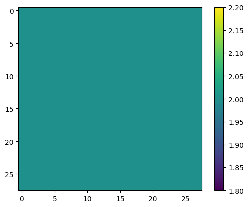

# Historical notebook: SDM.ipynb

Original SHA-256: `cbb41f0342c555fa71c218351ad3c9580684bea0b27b7d12ef59924f97df3e91`

Code is preserved in `SDM.py`. Outputs below are historical evidence, not newly verified results.

### Cell 2 output 1
```text
Drive already mounted at /content/drive; to attempt to forcibly remount, call drive.mount("/content/drive", force_remount=True).

```

### Cell 4 output 1
```text
'cuda'
```

### Cell 6 output 1
```text
AlexNet(
  (conv1): Sequential(
    (0): Conv2d(2, 50, kernel_size=(2, 2), stride=(2, 2))
    (1): ReLU()
  )
  (conv2): Sequential(
    (0): Conv2d(50, 100, kernel_size=(2, 2), stride=(1, 1), padding=same)
    (1): ReLU()
  )
  (fc1): Linear(in_features=19600, out_features=19600, bias=True)
  (fc2): Linear(in_features=19600, out_features=800, bias=True)
)
```

### Cell 7 output 1
```text
Python script already downloaded

```

### Cell 10 output 1
```text
loading checkpoint

```

## Cell 11
#SDM offline training

### Cell 13 output 1
```text
<Figure size 640x480 with 2 Axes>
```



### Cell 13 output 2
```text
i: 0 | RMS X: 12836699.0000000000 | RMS E: 21545504768.0000000000 | MMSE: 81.2474365234 | diff: 99999920.0000000000

i: 1 | RMS X: 593.5334472656 | RMS E: 0.1846229136 | MMSE: 77.7945327759 | diff: 3.4529037476

i: 2 | RMS X: 546.0784301758 | RMS E: 0.1329000294 | MMSE: 75.4018936157 | diff: 2.3926391602

i: 3 | RMS X: 514.6571044922 | RMS E: 0.1094350740 | MMSE: 73.5087738037 | diff: 1.8931198120

i: 4 | RMS X: 490.5829467773 | RMS E: 0.0956207961 | MMSE: 71.9156417847 | diff: 1.5931320190

i: 5 | RMS X: 470.8367309570 | RMS E: 0.0864305943 | MMSE: 70.5261001587 | diff: 1.3895416260

i: 6 | RMS X: 453.9829101562 | RMS E: 0.0798642188 | MMSE: 69.2856216431 | diff: 1.2404785156

i: 7 | RMS X: 439.2181396484 | RMS E: 0.0748918876 | MMSE: 68.1602478027 | diff: 1.1253738403

i: 8 | RMS X: 426.0473022461 | RMS E: 0.0709621608 | MMSE: 67.1272125244 | diff: 1.0330352783

i: 9 | RMS X: 414.1404113770 | RMS E: 0.0677686334 | MMSE: 66.1704559326 | diff: 0.9567565918

i: 10 | RMS X: 403.2665100098 | RMS E: 0.0651228204 | MMSE: 65.2781677246 | diff: 0.8922882080

i: 11 | RMS X: 393.2564392090 | RMS E: 0.0628828257 | MMSE: 64.4413375854 | diff: 0.8368301392

i: 12 | RMS X: 383.9817504883 | RMS E: 0.0609652214 | MMSE: 63.6529388428 | diff: 0.7883987427

i: 13 | RMS X: 375.3430175781 | RMS E: 0.0592981726 | MMSE: 62.9073753357 | diff: 0.7455635071

i: 14 | RMS X: 367.2611999512 | RMS E: 0.0578345843 | MMSE: 62.2000656128 | diff: 0.7073097229

i: 15 | RMS X: 359.6719055176 | RMS E: 0.0565390438 | MMSE: 61.5272178650 | diff: 0.6728477478

i: 16 | RMS X: 352.5221252441 | RMS E: 0.0553742610 | MMSE: 60.8856277466 | diff: 0.6415901184

i: 17 | RMS X: 345.7673645020 | RMS E: 0.0543187447 | MMSE: 60.2725677490 | diff: 0.6130599976

i: 18 | RMS X: 339.3698730469 | RMS E: 0.0533589907 | MMSE: 59.6856842041 | diff: 0.5868835449

i: 19 | RMS X: 333.2973022461 | RMS E: 0.0524854437 | MMSE: 59.1229324341 | diff: 0.5627517700

i: 20 | RMS X: 327.5216674805 | RMS E: 0.0516801998 | MMSE: 58.5825195312 | diff: 0.5404129028

i: 21 | RMS X: 322.0187072754 | RMS E: 0.0509320982 | MMSE: 58.0628433228 | diff: 0.5196762085

i: 22 | RMS X: 316.7669677734 | RMS E: 0.0502377003 | MMSE: 57.5625000000 | diff: 0.5003433228

i: 23 | RMS X: 311.7474060059 | RMS E: 0.0495920181 | MMSE: 57.0801963806 | diff: 0.4823036194

i: 24 | RMS X: 306.9430847168 | RMS E: 0.0489918217 | MMSE: 56.6148147583 | diff: 0.4653816223

i: 25 | RMS X: 302.3389282227 | RMS E: 0.0484276749 | MMSE: 56.1653137207 | diff: 0.4495010376

i: 26 | RMS X: 297.9213562012 | RMS E: 0.0478951782 | MMSE: 55.7307357788 | diff: 0.4345779419

i: 27 | RMS X: 293.6781616211 | RMS E: 0.0473905206 | MMSE: 55.3102569580 | diff: 0.4204788208

i: 28 | RMS X: 289.5982055664 | RMS E: 0.0469133332 | MMSE: 54.9030952454 | diff: 0.4071617126

i: 29 | RMS X: 285.6716918945 | RMS E: 0.0464619286 | MMSE: 54.5085449219 | diff: 0.3945503235

i: 30 | RMS X: 281.8892517090 | RMS E: 0.0460343994 | MMSE: 54.1259155273 | diff: 0.3826293945

i: 31 | RMS X: 278.2425231934 | RMS E: 0.0456294008 | MMSE: 53.7546234131 | diff: 0.3712921143

i: 32 | RMS X: 274.7236633301 | RMS E: 0.0452427305 | MMSE: 53.3940963745 | diff: 0.3605270386

i: 33 | RMS X: 271.3257141113 | RMS E: 0.0448749624 | MMSE: 53.0438308716 | diff: 0.3502655029

i: 34 | RMS X: 268.0422363281 | RMS E: 0.0445225909 | MMSE: 52.7033119202 | diff: 0.3405189514

i: 35 | RMS X: 264.8669738770 | RMS E: 0.0441848002 | MMSE: 52.3721084595 | diff: 0.3312034607

i: 36 | RMS X: 261.7943725586 | RMS E: 0.0438605770 | MMSE: 52.0497932434 | diff: 0.3223152161

i: 37 | RMS X: 258.8192138672 | RMS E: 0.0435502604 | MMSE: 51.7359580994 | diff: 0.3138351440

i: 38 | RMS X: 255.9366149902 | RMS E: 0.0432518385 | MMSE: 51.4302444458 | diff: 0.3057136536

i: 39 | RMS X: 253.1419677734 | RMS E: 0.0429656394 | MMSE: 51.1322822571 | diff: 0.2979621887

i: 40 | RMS X: 250.4311523438 | RMS E: 0.0426919311 | MMSE: 50.8417625427 | diff: 0.2905197144

i: 41 | RMS X: 247.8001403809 | RMS E: 0.0424283184 | MMSE: 50.5583648682 | diff: 0.2833976746

i: 42 | RMS X: 245.2453155518 | RMS E: 0.0421749912 | MMSE: 50.2818107605 | diff: 0.2765541077

i: 43 | RMS X: 242.7631225586 | RMS E: 0.0419315062 | MMSE: 50.0118255615 | diff: 0.2699851990

i: 44 | RMS X: 240.3504486084 | RMS E: 0.0416964255 | MMSE: 49.7481536865 | diff: 0.2636718750

i: 45 | RMS X: 238.0041809082 | RMS E: 0.0414707065 | MMSE: 49.4905433655 | diff: 0.2576103210

i: 46 | RMS X: 235.7214813232 | RMS E: 0.0412526838 | MMSE: 49.2387771606 | diff: 0.2517662048

i: 47 | RMS X: 233.4996643066 | RMS E: 0.0410423949 | MMSE: 48.9926414490 | diff: 0.2461357117

i: 48 | RMS X: 231.3362426758 | RMS E: 0.0408390202 | MMSE: 48.7519226074 | diff: 0.2407188416

i: 49 | RMS X: 229.2289123535 | RMS E: 0.0406418443 | MMSE: 48.5164375305 | diff: 0.2354850769

i: 50 | RMS X: 227.1753540039 | RMS E: 0.0404514782 | MMSE: 48.2860031128 | diff: 0.2304344177

i: 51 | RMS X: 225.1734466553 | RMS E: 0.0402664803 | MMSE: 48.0604248047 | diff: 0.2255783081

i: 52 | RMS X: 223.2212066650 | RMS E: 0.0400866717 | MMSE: 47.8395538330 | diff: 0.2208709717

i: 53 | RMS X: 221.3167266846 | RMS E: 0.0399121344 | MMSE: 47.6232299805 | diff: 0.2163238525

i: 54 | RMS X: 219.4582366943 | RMS E: 0.0397425964 | MMSE: 47.4112930298 | diff: 0.2119369507

i: 55 | RMS X: 217.6439514160 | RMS E: 0.0395782851 | MMSE: 47.2036018372 | diff: 0.2076911926

i: 56 | RMS X: 215.8722839355 | RMS E: 0.0394188762 | MMSE: 47.0000228882 | diff: 0.2035789490

i: 57 | RMS X: 214.1416931152 | RMS E: 0.0392645150 | MMSE: 46.8004226685 | diff: 0.1996002197

i: 58 | RMS X: 212.4506683350 | RMS E: 0.0391147844 | MMSE: 46.6046600342 | diff: 0.1957626343

i: 59 | RMS X: 210.7978057861 | RMS E: 0.0389698744 | MMSE: 46.4126358032 | diff: 0.1920242310

i: 60 | RMS X: 209.1817779541 | RMS E: 0.0388300642 | MMSE: 46.2242088318 | diff: 0.1884269714

i: 61 | RMS X: 207.6012573242 | RMS E: 0.0386946537 | MMSE: 46.0392875671 | diff: 0.1849212646

i: 62 | RMS X: 206.0550231934 | RMS E: 0.0385636427 | MMSE: 45.8577384949 | diff: 0.1815490723

i: 63 | RMS X: 204.5418548584 | RMS E: 0.0384360850 | MMSE: 45.6794929504 | diff: 0.1782455444

i: 64 | RMS X: 203.0607147217 | RMS E: 0.0383116603 | MMSE: 45.5044326782 | diff: 0.1750602722

i: 65 | RMS X: 201.6105499268 | RMS E: 0.0381902382 | MMSE: 45.3324699402 | diff: 0.1719627380

i: 66 | RMS X: 200.1903076172 | RMS E: 0.0380719602 | MMSE: 45.1635131836 | diff: 0.1689567566

i: 67 | RMS X: 198.7990417480 | RMS E: 0.0379567593 | MMSE: 44.9974746704 | diff: 0.1660385132

i: 68 | RMS X: 197.4358062744 | RMS E: 0.0378443338 | MMSE: 44.8342742920 | diff: 0.1632003784

i: 69 | RMS X: 196.0997467041 | RMS E: 0.0377344936 | MMSE: 44.6738319397 | diff: 0.1604423523

i: 70 | RMS X: 194.7900238037 | RMS E: 0.0376269296 | MMSE: 44.5160713196 | diff: 0.1577606201

i: 71 | RMS X: 193.5057983398 | RMS E: 0.0375218913 | MMSE: 44.3609199524 | diff: 0.1551513672

i: 72 | RMS X: 192.2463226318 | RMS E: 0.0374190323 | MMSE: 44.2083091736 | diff: 0.1526107788

i: 73 | RMS X: 191.0108489990 | RMS E: 0.0373183489 | MMSE: 44.0581703186 | diff: 0.1501388550

i: 74 | RMS X: 189.7986297607 | RMS E: 0.0372198597 | MMSE: 43.9104347229 | diff: 0.1477355957

i: 75 | RMS X: 188.6090393066 | RMS E: 0.0371236168 | MMSE: 43.7650375366 | diff: 0.1453971863

i: 76 | RMS X: 187.4413909912 | RMS E: 0.0370296314 | MMSE: 43.6219215393 | diff: 0.1431159973

i: 77 | RMS X: 186.2950286865 | RMS E: 0.0369372852 | MMSE: 43.4810218811 | diff: 0.1408996582

i: 78 | RMS X: 185.1693725586 | RMS E: 0.0368468016 | MMSE: 43.3422889709 | diff: 0.1387329102

i: 79 | RMS X: 184.0638275146 | RMS E: 0.0367583372 | MMSE: 43.2056655884 | diff: 0.1366233826

i: 80 | RMS X: 182.9778289795 | RMS E: 0.0366720781 | MMSE: 43.0710983276 | diff: 0.1345672607

i: 81 | RMS X: 181.9108428955 | RMS E: 0.0365879275 | MMSE: 42.9385337830 | diff: 0.1325645447

i: 82 | RMS X: 180.8623199463 | RMS E: 0.0365055986 | MMSE: 42.8079261780 | diff: 0.1306076050

i: 83 | RMS X: 179.8317565918 | RMS E: 0.0364248455 | MMSE: 42.6792182922 | diff: 0.1287078857

i: 84 | RMS X: 178.8186492920 | RMS E: 0.0363458097 | MMSE: 42.5523681641 | diff: 0.1268501282

i: 85 | RMS X: 177.8225402832 | RMS E: 0.0362680927 | MMSE: 42.4273414612 | diff: 0.1250267029

i: 86 | RMS X: 176.8429870605 | RMS E: 0.0361917093 | MMSE: 42.3040771484 | diff: 0.1232643127

i: 87 | RMS X: 175.8795623779 | RMS E: 0.0361165069 | MMSE: 42.1825523376 | diff: 0.1215248108

i: 88 | RMS X: 174.9318542480 | RMS E: 0.0360431336 | MMSE: 42.0627136230 | diff: 0.1198387146

i: 89 | RMS X: 173.9994506836 | RMS E: 0.0359710194 | MMSE: 41.9445228577 | diff: 0.1181907654

i: 90 | RMS X: 173.0819396973 | RMS E: 0.0359004773 | MMSE: 41.8279533386 | diff: 0.1165695190

i: 91 | RMS X: 172.1789550781 | RMS E: 0.0358312093 | MMSE: 41.7129554749 | diff: 0.1149978638

i: 92 | RMS X: 171.2901763916 | RMS E: 0.0357632227 | MMSE: 41.5994987488 | diff: 0.1134567261

i: 93 | RMS X: 170.4152069092 | RMS E: 0.0356963500 | MMSE: 41.4875564575 | diff: 0.1119422913

i: 94 | RMS X: 169.5537414551 | RMS E: 0.0356301107 | MMSE: 41.3770828247 | diff: 0.1104736328

i: 95 | RMS X: 168.7054290771 | RMS E: 0.0355646648 | MMSE: 41.2680587769 | diff: 0.1090240479

i: 96 | RMS X: 167.8699798584 | RMS E: 0.0355002210 | MMSE: 41.1604461670 | diff: 0.1076126099

i: 97 | RMS X: 167.0470886230 | RMS E: 0.0354367718 | MMSE: 41.0542144775 | diff: 0.1062316895

i: 98 | RMS X: 166.2364349365 | RMS E: 0.0353742354 | MMSE: 40.9493331909 | diff: 0.1048812866

i: 99 | RMS X: 165.4377593994 | RMS E: 0.0353124849 | MMSE: 40.8457756042 | diff: 0.1035575867

i: 100 | RMS X: 164.6507568359 | RMS E: 0.0352515504 | MMSE: 40.7435226440 | diff: 0.1022529602

i: 101 | RMS X: 163.8751678467 | RMS E: 0.0351915322 | MMSE: 40.6425285339 | diff: 0.1009941101

i: 102 | RMS X: 163.1107635498 | RMS E: 0.0351326391 | MMSE: 40.5427818298 | diff: 0.0997467041

i: 103 | RMS X: 162.3572082520 | RMS E: 0.0350745507 | MMSE: 40.4442520142 | diff: 0.0985298157

i: 104 | RMS X: 161.6143188477 | RMS E: 0.0350170992 | MMSE: 40.3469123840 | diff: 0.0973396301

i: 105 | RMS X: 160.8818359375 | RMS E: 0.0349603668 | MMSE: 40.2507476807 | diff: 0.0961647034

i: 106 | RMS X: 160.1595458984 | RMS E: 0.0349042080 | MMSE: 40.1557197571 | diff: 0.0950279236

i: 107 | RMS X: 159.4472198486 | RMS E: 0.0348487161 | MMSE: 40.0618171692 | diff: 0.0939025879

i: 108 | RMS X: 158.7446136475 | RMS E: 0.0347940847 | MMSE: 39.9690170288 | diff: 0.0928001404

i: 109 | RMS X: 158.0515441895 | RMS E: 0.0347400606 | MMSE: 39.8772964478 | diff: 0.0917205811

i: 110 | RMS X: 157.3677978516 | RMS E: 0.0346865878 | MMSE: 39.7866287231 | diff: 0.0906677246

i: 111 | RMS X: 156.6931762695 | RMS E: 0.0346337333 | MMSE: 39.6970062256 | diff: 0.0896224976

i: 112 | RMS X: 156.0274810791 | RMS E: 0.0345817693 | MMSE: 39.6083984375 | diff: 0.0886077881

i: 113 | RMS X: 155.3705444336 | RMS E: 0.0345305726 | MMSE: 39.5207939148 | diff: 0.0876045227

i: 114 | RMS X: 154.7221984863 | RMS E: 0.0344800279 | MMSE: 39.4341659546 | diff: 0.0866279602

i: 115 | RMS X: 154.0822143555 | RMS E: 0.0344302058 | MMSE: 39.3485031128 | diff: 0.0856628418

i: 116 | RMS X: 153.4504547119 | RMS E: 0.0343809798 | MMSE: 39.2637863159 | diff: 0.0847167969

i: 117 | RMS X: 152.8267517090 | RMS E: 0.0343324095 | MMSE: 39.1799964905 | diff: 0.0837898254

i: 118 | RMS X: 152.2109222412 | RMS E: 0.0342846029 | MMSE: 39.0971107483 | diff: 0.0828857422

i: 119 | RMS X: 151.6028137207 | RMS E: 0.0342374295 | MMSE: 39.0151290894 | diff: 0.0819816589

i: 120 | RMS X: 151.0023040771 | RMS E: 0.0341907255 | MMSE: 38.9340171814 | diff: 0.0811119080

i: 121 | RMS X: 150.4091949463 | RMS E: 0.0341445841 | MMSE: 38.8537750244 | diff: 0.0802421570

i: 122 | RMS X: 149.8233642578 | RMS E: 0.0340989865 | MMSE: 38.7743721008 | diff: 0.0794029236

i: 123 | RMS X: 149.2446594238 | RMS E: 0.0340539962 | MMSE: 38.6958084106 | diff: 0.0785636902

i: 124 | RMS X: 148.6729736328 | RMS E: 0.0340095200 | MMSE: 38.6180572510 | diff: 0.0777511597

i: 125 | RMS X: 148.1081237793 | RMS E: 0.0339656025 | MMSE: 38.5411109924 | diff: 0.0769462585

i: 126 | RMS X: 147.5500335693 | RMS E: 0.0339223444 | MMSE: 38.4649581909 | diff: 0.0761528015

i: 127 | RMS X: 146.9985504150 | RMS E: 0.0338796601 | MMSE: 38.3895759583 | diff: 0.0753822327

i: 128 | RMS X: 146.4535522461 | RMS E: 0.0338375159 | MMSE: 38.3149604797 | diff: 0.0746154785

i: 129 | RMS X: 145.9149017334 | RMS E: 0.0337959118 | MMSE: 38.2410964966 | diff: 0.0738639832

i: 130 | RMS X: 145.3825378418 | RMS E: 0.0337546244 | MMSE: 38.1679687500 | diff: 0.0731277466

i: 131 | RMS X: 144.8562774658 | RMS E: 0.0337136537 | MMSE: 38.0955734253 | diff: 0.0723953247

i: 132 | RMS X: 144.3360748291 | RMS E: 0.0336731598 | MMSE: 38.0238838196 | diff: 0.0716896057

i: 133 | RMS X: 143.8217773438 | RMS E: 0.0336331986 | MMSE: 37.9529037476 | diff: 0.0709800720

i: 134 | RMS X: 143.3132629395 | RMS E: 0.0335937701 | MMSE: 37.8826065063 | diff: 0.0702972412

i: 135 | RMS X: 142.8104553223 | RMS E: 0.0335547999 | MMSE: 37.8129959106 | diff: 0.0696105957

i: 136 | RMS X: 142.3132629395 | RMS E: 0.0335162506 | MMSE: 37.7440490723 | diff: 0.0689468384

i: 137 | RMS X: 141.8215484619 | RMS E: 0.0334779657 | MMSE: 37.6757621765 | diff: 0.0682868958

i: 138 | RMS X: 141.3352508545 | RMS E: 0.0334400721 | MMSE: 37.6081199646 | diff: 0.0676422119

i: 139 | RMS X: 140.8542480469 | RMS E: 0.0334025323 | MMSE: 37.5411148071 | diff: 0.0670051575

i: 140 | RMS X: 140.3784637451 | RMS E: 0.0333653241 | MMSE: 37.4747314453 | diff: 0.0663833618

i: 141 | RMS X: 139.9078063965 | RMS E: 0.0333285257 | MMSE: 37.4089736938 | diff: 0.0657577515

i: 142 | RMS X: 139.4421844482 | RMS E: 0.0332920142 | MMSE: 37.3438186646 | diff: 0.0651550293

i: 143 | RMS X: 138.9815216064 | RMS E: 0.0332559049 | MMSE: 37.2792625427 | diff: 0.0645561218

i: 144 | RMS X: 138.5257263184 | RMS E: 0.0332201906 | MMSE: 37.2152900696 | diff: 0.0639724731

i: 145 | RMS X: 138.0746917725 | RMS E: 0.0331849046 | MMSE: 37.1519012451 | diff: 0.0633888245

i: 146 | RMS X: 137.6283569336 | RMS E: 0.0331500471 | MMSE: 37.0890846252 | diff: 0.0628166199

i: 147 | RMS X: 137.1866912842 | RMS E: 0.0331154056 | MMSE: 37.0268287659 | diff: 0.0622558594

i: 148 | RMS X: 136.7495574951 | RMS E: 0.0330810361 | MMSE: 36.9651260376 | diff: 0.0617027283

i: 149 | RMS X: 136.3168792725 | RMS E: 0.0330468677 | MMSE: 36.9039726257 | diff: 0.0611534119

i: 150 | RMS X: 135.8886260986 | RMS E: 0.0330127701 | MMSE: 36.8433494568 | diff: 0.0606231689

i: 151 | RMS X: 135.4646911621 | RMS E: 0.0329790376 | MMSE: 36.7832603455 | diff: 0.0600891113

i: 152 | RMS X: 135.0450134277 | RMS E: 0.0329455771 | MMSE: 36.7236938477 | diff: 0.0595664978

i: 153 | RMS X: 134.6295623779 | RMS E: 0.0329125151 | MMSE: 36.6646423340 | diff: 0.0590515137

i: 154 | RMS X: 134.2182006836 | RMS E: 0.0328798294 | MMSE: 36.6060943604 | diff: 0.0585479736

i: 155 | RMS X: 133.8108978271 | RMS E: 0.0328474492 | MMSE: 36.5480499268 | diff: 0.0580444336

i: 156 | RMS X: 133.4075927734 | RMS E: 0.0328153595 | MMSE: 36.4904937744 | diff: 0.0575561523

i: 157 | RMS X: 133.0082092285 | RMS E: 0.0327835679 | MMSE: 36.4334259033 | diff: 0.0570678711

i: 158 | RMS X: 132.6127166748 | RMS E: 0.0327521451 | MMSE: 36.3768348694 | diff: 0.0565910339

i: 159 | RMS X: 132.2210235596 | RMS E: 0.0327211432 | MMSE: 36.3207168579 | diff: 0.0561180115

i: 160 | RMS X: 131.8330841064 | RMS E: 0.0326902755 | MMSE: 36.2650604248 | diff: 0.0556564331

i: 161 | RMS X: 131.4488372803 | RMS E: 0.0326597504 | MMSE: 36.2098655701 | diff: 0.0551948547

i: 162 | RMS X: 131.0682220459 | RMS E: 0.0326294675 | MMSE: 36.1551246643 | diff: 0.0547409058

i: 163 | RMS X: 130.6912231445 | RMS E: 0.0325995050 | MMSE: 36.1008300781 | diff: 0.0542945862

i: 164 | RMS X: 130.3177337646 | RMS E: 0.0325699076 | MMSE: 36.0469741821 | diff: 0.0538558960

i: 165 | RMS X: 129.9477081299 | RMS E: 0.0325406305 | MMSE: 35.9935531616 | diff: 0.0534210205

i: 166 | RMS X: 129.5811309814 | RMS E: 0.0325115100 | MMSE: 35.9405593872 | diff: 0.0529937744

i: 167 | RMS X: 129.2179107666 | RMS E: 0.0324826390 | MMSE: 35.8879890442 | diff: 0.0525703430

i: 168 | RMS X: 128.8580322266 | RMS E: 0.0324540436 | MMSE: 35.8358383179 | diff: 0.0521507263

i: 169 | RMS X: 128.5014343262 | RMS E: 0.0324257091 | MMSE: 35.7840957642 | diff: 0.0517425537

i: 170 | RMS X: 128.1480407715 | RMS E: 0.0323977023 | MMSE: 35.7327537537 | diff: 0.0513420105

i: 171 | RMS X: 127.7978439331 | RMS E: 0.0323698372 | MMSE: 35.6818199158 | diff: 0.0509338379

i: 172 | RMS X: 127.4507675171 | RMS E: 0.0323420949 | MMSE: 35.6312828064 | diff: 0.0505371094

i: 173 | RMS X: 127.1068038940 | RMS E: 0.0323146358 | MMSE: 35.5811271667 | diff: 0.0501556396

i: 174 | RMS X: 126.7658843994 | RMS E: 0.0322873592 | MMSE: 35.5313682556 | diff: 0.0497589111

i: 175 | RMS X: 126.4279556274 | RMS E: 0.0322604366 | MMSE: 35.4819831848 | diff: 0.0493850708

i: 176 | RMS X: 126.0930023193 | RMS E: 0.0322336629 | MMSE: 35.4329757690 | diff: 0.0490074158

i: 177 | RMS X: 125.7609710693 | RMS E: 0.0322072022 | MMSE: 35.3843345642 | diff: 0.0486412048

i: 178 | RMS X: 125.4318084717 | RMS E: 0.0321809575 | MMSE: 35.3360633850 | diff: 0.0482711792

i: 179 | RMS X: 125.1054916382 | RMS E: 0.0321548656 | MMSE: 35.2881546021 | diff: 0.0479087830

i: 180 | RMS X: 124.7819900513 | RMS E: 0.0321288966 | MMSE: 35.2406005859 | diff: 0.0475540161

i: 181 | RMS X: 124.4612350464 | RMS E: 0.0321031027 | MMSE: 35.1933975220 | diff: 0.0472030640

i: 182 | RMS X: 124.1431884766 | RMS E: 0.0320774503 | MMSE: 35.1465415955 | diff: 0.0468559265

i: 183 | RMS X: 123.8278656006 | RMS E: 0.0320519842 | MMSE: 35.1000328064 | diff: 0.0465087891

i: 184 | RMS X: 123.5151748657 | RMS E: 0.0320266113 | MMSE: 35.0538635254 | diff: 0.0461692810

i: 185 | RMS X: 123.2051162720 | RMS E: 0.0320013463 | MMSE: 35.0080299377 | diff: 0.0458335876

i: 186 | RMS X: 122.8976058960 | RMS E: 0.0319763236 | MMSE: 34.9625282288 | diff: 0.0455017090

i: 187 | RMS X: 122.5926818848 | RMS E: 0.0319513828 | MMSE: 34.9173545837 | diff: 0.0451736450

i: 188 | RMS X: 122.2902526855 | RMS E: 0.0319265500 | MMSE: 34.8725013733 | diff: 0.0448532104

i: 189 | RMS X: 121.9902954102 | RMS E: 0.0319018736 | MMSE: 34.8279724121 | diff: 0.0445289612

i: 190 | RMS X: 121.6927871704 | RMS E: 0.0318773426 | MMSE: 34.7837562561 | diff: 0.0442161560

i: 191 | RMS X: 121.3977050781 | RMS E: 0.0318530127 | MMSE: 34.7398490906 | diff: 0.0439071655

i: 192 | RMS X: 121.1049880981 | RMS E: 0.0318287984 | MMSE: 34.6962547302 | diff: 0.0435943604

i: 193 | RMS X: 120.8146286011 | RMS E: 0.0318047591 | MMSE: 34.6529617310 | diff: 0.0432929993

i: 194 | RMS X: 120.5265960693 | RMS E: 0.0317809507 | MMSE: 34.6099739075 | diff: 0.0429878235

i: 195 | RMS X: 120.2408370972 | RMS E: 0.0317573659 | MMSE: 34.5672760010 | diff: 0.0426979065

i: 196 | RMS X: 119.9573593140 | RMS E: 0.0317339785 | MMSE: 34.5248756409 | diff: 0.0424003601

i: 197 | RMS X: 119.6761016846 | RMS E: 0.0317107067 | MMSE: 34.4827651978 | diff: 0.0421104431

i: 198 | RMS X: 119.3970413208 | RMS E: 0.0316875465 | MMSE: 34.4409408569 | diff: 0.0418243408

i: 199 | RMS X: 119.1201629639 | RMS E: 0.0316645056 | MMSE: 34.3994026184 | diff: 0.0415382385

i: 200 | RMS X: 118.8454513550 | RMS E: 0.0316416621 | MMSE: 34.3581428528 | diff: 0.0412597656

i: 201 | RMS X: 118.5728225708 | RMS E: 0.0316189080 | MMSE: 34.3171615601 | diff: 0.0409812927

i: 202 | RMS X: 118.3023223877 | RMS E: 0.0315963328 | MMSE: 34.2764511108 | diff: 0.0407104492

i: 203 | RMS X: 118.0338745117 | RMS E: 0.0315737985 | MMSE: 34.2360191345 | diff: 0.0404319763

i: 204 | RMS X: 117.7674713135 | RMS E: 0.0315514803 | MMSE: 34.1958503723 | diff: 0.0401687622

i: 205 | RMS X: 117.5030670166 | RMS E: 0.0315291770 | MMSE: 34.1559410095 | diff: 0.0399093628

i: 206 | RMS X: 117.2406845093 | RMS E: 0.0315070786 | MMSE: 34.1163024902 | diff: 0.0396385193

i: 207 | RMS X: 116.9802474976 | RMS E: 0.0314851366 | MMSE: 34.0769195557 | diff: 0.0393829346

i: 208 | RMS X: 116.7217559814 | RMS E: 0.0314633884 | MMSE: 34.0377922058 | diff: 0.0391273499

i: 209 | RMS X: 116.4652023315 | RMS E: 0.0314417593 | MMSE: 33.9989166260 | diff: 0.0388755798

i: 210 | RMS X: 116.2105407715 | RMS E: 0.0314203948 | MMSE: 33.9602928162 | diff: 0.0386238098

i: 211 | RMS X: 115.9577331543 | RMS E: 0.0313991271 | MMSE: 33.9219207764 | diff: 0.0383720398

i: 212 | RMS X: 115.7067947388 | RMS E: 0.0313780308 | MMSE: 33.8837890625 | diff: 0.0381317139

i: 213 | RMS X: 115.4576873779 | RMS E: 0.0313570723 | MMSE: 33.8458976746 | diff: 0.0378913879

i: 214 | RMS X: 115.2103881836 | RMS E: 0.0313362181 | MMSE: 33.8082504272 | diff: 0.0376472473

i: 215 | RMS X: 114.9648666382 | RMS E: 0.0313154049 | MMSE: 33.7708396912 | diff: 0.0374107361

i: 216 | RMS X: 114.7211151123 | RMS E: 0.0312946476 | MMSE: 33.7336616516 | diff: 0.0371780396

i: 217 | RMS X: 114.4790954590 | RMS E: 0.0312738717 | MMSE: 33.6967201233 | diff: 0.0369415283

i: 218 | RMS X: 114.2388076782 | RMS E: 0.0312532559 | MMSE: 33.6600036621 | diff: 0.0367164612

i: 219 | RMS X: 114.0002212524 | RMS E: 0.0312327910 | MMSE: 33.6235160828 | diff: 0.0364875793

i: 220 | RMS X: 113.7633285522 | RMS E: 0.0312123261 | MMSE: 33.5872535706 | diff: 0.0362625122

i: 221 | RMS X: 113.5280914307 | RMS E: 0.0311919376 | MMSE: 33.5512123108 | diff: 0.0360412598

i: 222 | RMS X: 113.2945175171 | RMS E: 0.0311716665 | MMSE: 33.5153884888 | diff: 0.0358238220

i: 223 | RMS X: 113.0625457764 | RMS E: 0.0311514232 | MMSE: 33.4797897339 | diff: 0.0355987549

i: 224 | RMS X: 112.8322143555 | RMS E: 0.0311312824 | MMSE: 33.4444007874 | diff: 0.0353889465

i: 225 | RMS X: 112.6034469604 | RMS E: 0.0311112124 | MMSE: 33.4092292786 | diff: 0.0351715088

i: 226 | RMS X: 112.3762588501 | RMS E: 0.0310912784 | MMSE: 33.3742675781 | diff: 0.0349617004

i: 227 | RMS X: 112.1506271362 | RMS E: 0.0310715009 | MMSE: 33.3395156860 | diff: 0.0347518921

i: 228 | RMS X: 111.9265289307 | RMS E: 0.0310519189 | MMSE: 33.3049697876 | diff: 0.0345458984

i: 229 | RMS X: 111.7039642334 | RMS E: 0.0310323574 | MMSE: 33.2706260681 | diff: 0.0343437195

i: 230 | RMS X: 111.4829101562 | RMS E: 0.0310129486 | MMSE: 33.2364883423 | diff: 0.0341377258

i: 231 | RMS X: 111.2633209229 | RMS E: 0.0309935547 | MMSE: 33.2025527954 | diff: 0.0339355469

i: 232 | RMS X: 111.0452117920 | RMS E: 0.0309744012 | MMSE: 33.1688117981 | diff: 0.0337409973

i: 233 | RMS X: 110.8285675049 | RMS E: 0.0309551712 | MMSE: 33.1352691650 | diff: 0.0335426331

i: 234 | RMS X: 110.6133575439 | RMS E: 0.0309361275 | MMSE: 33.1019210815 | diff: 0.0333480835

i: 235 | RMS X: 110.3995666504 | RMS E: 0.0309171565 | MMSE: 33.0687637329 | diff: 0.0331573486

i: 236 | RMS X: 110.1871948242 | RMS E: 0.0308982749 | MMSE: 33.0358009338 | diff: 0.0329627991

i: 237 | RMS X: 109.9762115479 | RMS E: 0.0308794733 | MMSE: 33.0030250549 | diff: 0.0327758789

i: 238 | RMS X: 109.7666015625 | RMS E: 0.0308606755 | MMSE: 32.9704399109 | diff: 0.0325851440

i: 239 | RMS X: 109.5583648682 | RMS E: 0.0308420304 | MMSE: 32.9380340576 | diff: 0.0324058533

i: 240 | RMS X: 109.3514633179 | RMS E: 0.0308233760 | MMSE: 32.9058151245 | diff: 0.0322189331

i: 241 | RMS X: 109.1459121704 | RMS E: 0.0308048446 | MMSE: 32.8737792969 | diff: 0.0320358276

i: 242 | RMS X: 108.9416656494 | RMS E: 0.0307863988 | MMSE: 32.8419189453 | diff: 0.0318603516

i: 243 | RMS X: 108.7387466431 | RMS E: 0.0307680778 | MMSE: 32.8102416992 | diff: 0.0316772461

i: 244 | RMS X: 108.5371246338 | RMS E: 0.0307498090 | MMSE: 32.7787399292 | diff: 0.0315017700

i: 245 | RMS X: 108.3367691040 | RMS E: 0.0307315141 | MMSE: 32.7474136353 | diff: 0.0313262939

i: 246 | RMS X: 108.1376724243 | RMS E: 0.0307132658 | MMSE: 32.7162590027 | diff: 0.0311546326

i: 247 | RMS X: 107.9398498535 | RMS E: 0.0306950808 | MMSE: 32.6852760315 | diff: 0.0309829712

i: 248 | RMS X: 107.7432861328 | RMS E: 0.0306769796 | MMSE: 32.6544609070 | diff: 0.0308151245

i: 249 | RMS X: 107.5479125977 | RMS E: 0.0306589603 | MMSE: 32.6238174438 | diff: 0.0306434631

i: 250 | RMS X: 107.3537750244 | RMS E: 0.0306409691 | MMSE: 32.5933418274 | diff: 0.0304756165

i: 251 | RMS X: 107.1608276367 | RMS E: 0.0306231026 | MMSE: 32.5630264282 | diff: 0.0303153992

i: 252 | RMS X: 106.9690933228 | RMS E: 0.0306052715 | MMSE: 32.5328788757 | diff: 0.0301475525

i: 253 | RMS X: 106.7785263062 | RMS E: 0.0305875503 | MMSE: 32.5028915405 | diff: 0.0299873352

i: 254 | RMS X: 106.5891265869 | RMS E: 0.0305699222 | MMSE: 32.4730682373 | diff: 0.0298233032

i: 255 | RMS X: 106.4008865356 | RMS E: 0.0305523425 | MMSE: 32.4433975220 | diff: 0.0296707153

i: 256 | RMS X: 106.2137832642 | RMS E: 0.0305348132 | MMSE: 32.4138908386 | diff: 0.0295066833

i: 257 | RMS X: 106.0278167725 | RMS E: 0.0305173602 | MMSE: 32.3845367432 | diff: 0.0293540955

i: 258 | RMS X: 105.8429718018 | RMS E: 0.0304999296 | MMSE: 32.3553428650 | diff: 0.0291938782

i: 259 | RMS X: 105.6592330933 | RMS E: 0.0304825921 | MMSE: 32.3262939453 | diff: 0.0290489197

i: 260 | RMS X: 105.4765853882 | RMS E: 0.0304653551 | MMSE: 32.2974052429 | diff: 0.0288887024

i: 261 | RMS X: 105.2950592041 | RMS E: 0.0304480419 | MMSE: 32.2686653137 | diff: 0.0287399292

i: 262 | RMS X: 105.1145858765 | RMS E: 0.0304308571 | MMSE: 32.2400703430 | diff: 0.0285949707

i: 263 | RMS X: 104.9351959229 | RMS E: 0.0304136984 | MMSE: 32.2116279602 | diff: 0.0284423828

i: 264 | RMS X: 104.7568435669 | RMS E: 0.0303966701 | MMSE: 32.1833343506 | diff: 0.0282936096

i: 265 | RMS X: 104.5795669556 | RMS E: 0.0303796846 | MMSE: 32.1551818848 | diff: 0.0281524658

i: 266 | RMS X: 104.4033126831 | RMS E: 0.0303626563 | MMSE: 32.1271743774 | diff: 0.0280075073

i: 267 | RMS X: 104.2280883789 | RMS E: 0.0303457528 | MMSE: 32.0993080139 | diff: 0.0278663635

i: 268 | RMS X: 104.0538864136 | RMS E: 0.0303288978 | MMSE: 32.0715904236 | diff: 0.0277175903

i: 269 | RMS X: 103.8806991577 | RMS E: 0.0303120837 | MMSE: 32.0440101624 | diff: 0.0275802612

i: 270 | RMS X: 103.7085189819 | RMS E: 0.0302953366 | MMSE: 32.0165672302 | diff: 0.0274429321

i: 271 | RMS X: 103.5373077393 | RMS E: 0.0302785244 | MMSE: 31.9892654419 | diff: 0.0273017883

i: 272 | RMS X: 103.3670883179 | RMS E: 0.0302619413 | MMSE: 31.9621009827 | diff: 0.0271644592

i: 273 | RMS X: 103.1978302002 | RMS E: 0.0302453060 | MMSE: 31.9350681305 | diff: 0.0270328522

i: 274 | RMS X: 103.0295639038 | RMS E: 0.0302287340 | MMSE: 31.9081726074 | diff: 0.0268955231

i: 275 | RMS X: 102.8622207642 | RMS E: 0.0302122030 | MMSE: 31.8814125061 | diff: 0.0267601013

i: 276 | RMS X: 102.6958312988 | RMS E: 0.0301957428 | MMSE: 31.8547801971 | diff: 0.0266323090

i: 277 | RMS X: 102.5303955078 | RMS E: 0.0301793497 | MMSE: 31.8282833099 | diff: 0.0264968872

i: 278 | RMS X: 102.3658676147 | RMS E: 0.0301630180 | MMSE: 31.8019161224 | diff: 0.0263671875

i: 279 | RMS X: 102.2022552490 | RMS E: 0.0301467218 | MMSE: 31.7756767273 | diff: 0.0262393951

i: 280 | RMS X: 102.0395736694 | RMS E: 0.0301304869 | MMSE: 31.7495651245 | diff: 0.0261116028

i: 281 | RMS X: 101.8777923584 | RMS E: 0.0301144421 | MMSE: 31.7235832214 | diff: 0.0259819031

i: 282 | RMS X: 101.7168960571 | RMS E: 0.0300984029 | MMSE: 31.6977233887 | diff: 0.0258598328

i: 283 | RMS X: 101.5568923950 | RMS E: 0.0300824400 | MMSE: 31.6719932556 | diff: 0.0257301331

i: 284 | RMS X: 101.3977737427 | RMS E: 0.0300665703 | MMSE: 31.6463832855 | diff: 0.0256099701

i: 285 | RMS X: 101.2395172119 | RMS E: 0.0300507396 | MMSE: 31.6208992004 | diff: 0.0254840851

i: 286 | RMS X: 101.0821228027 | RMS E: 0.0300349798 | MMSE: 31.5955352783 | diff: 0.0253639221

i: 287 | RMS X: 100.9255828857 | RMS E: 0.0300193336 | MMSE: 31.5702896118 | diff: 0.0252456665

i: 288 | RMS X: 100.7698974609 | RMS E: 0.0300037153 | MMSE: 31.5451660156 | diff: 0.0251235962

i: 289 | RMS X: 100.6150588989 | RMS E: 0.0299880505 | MMSE: 31.5201625824 | diff: 0.0250034332

i: 290 | RMS X: 100.4610366821 | RMS E: 0.0299726073 | MMSE: 31.4952754974 | diff: 0.0248870850

i: 291 | RMS X: 100.3078613281 | RMS E: 0.0299572628 | MMSE: 31.4705047607 | diff: 0.0247707367

i: 292 | RMS X: 100.1554870605 | RMS E: 0.0299418867 | MMSE: 31.4458541870 | diff: 0.0246505737

i: 293 | RMS X: 100.0039367676 | RMS E: 0.0299265794 | MMSE: 31.4213161469 | diff: 0.0245380402

i: 294 | RMS X: 99.8531723022 | RMS E: 0.0299113523 | MMSE: 31.3968925476 | diff: 0.0244235992

i: 295 | RMS X: 99.7032165527 | RMS E: 0.0298962072 | MMSE: 31.3725833893 | diff: 0.0243091583

i: 296 | RMS X: 99.5540542603 | RMS E: 0.0298811141 | MMSE: 31.3483829498 | diff: 0.0242004395

i: 297 | RMS X: 99.4056701660 | RMS E: 0.0298661292 | MMSE: 31.3242950439 | diff: 0.0240879059

i: 298 | RMS X: 99.2580566406 | RMS E: 0.0298512317 | MMSE: 31.3003177643 | diff: 0.0239772797

i: 299 | RMS X: 99.1112136841 | RMS E: 0.0298363790 | MMSE: 31.2764511108 | diff: 0.0238666534

i: 300 | RMS X: 98.9651412964 | RMS E: 0.0298216343 | MMSE: 31.2526950836 | diff: 0.0237560272

i: 301 | RMS X: 98.8198242188 | RMS E: 0.0298069119 | MMSE: 31.2290439606 | diff: 0.0236511230

i: 302 | RMS X: 98.6752548218 | RMS E: 0.0297921654 | MMSE: 31.2054977417 | diff: 0.0235462189

i: 303 | RMS X: 98.5314331055 | RMS E: 0.0297774915 | MMSE: 31.1820640564 | diff: 0.0234336853

i: 304 | RMS X: 98.3883514404 | RMS E: 0.0297628101 | MMSE: 31.1587314606 | diff: 0.0233325958

i: 305 | RMS X: 98.2459869385 | RMS E: 0.0297481827 | MMSE: 31.1355056763 | diff: 0.0232257843

i: 306 | RMS X: 98.1043472290 | RMS E: 0.0297336206 | MMSE: 31.1123828888 | diff: 0.0231227875

i: 307 | RMS X: 97.9634399414 | RMS E: 0.0297190845 | MMSE: 31.0893630981 | diff: 0.0230197906

i: 308 | RMS X: 97.8232421875 | RMS E: 0.0297046546 | MMSE: 31.0664463043 | diff: 0.0229167938

i: 309 | RMS X: 97.6837539673 | RMS E: 0.0296902545 | MMSE: 31.0436248779 | diff: 0.0228214264

i: 310 | RMS X: 97.5449523926 | RMS E: 0.0296758879 | MMSE: 31.0209102631 | diff: 0.0227146149

i: 311 | RMS X: 97.4068527222 | RMS E: 0.0296616461 | MMSE: 30.9982948303 | diff: 0.0226154327

i: 312 | RMS X: 97.2694549561 | RMS E: 0.0296474192 | MMSE: 30.9757766724 | diff: 0.0225181580

i: 313 | RMS X: 97.1327209473 | RMS E: 0.0296333339 | MMSE: 30.9533576965 | diff: 0.0224189758

i: 314 | RMS X: 96.9966812134 | RMS E: 0.0296192728 | MMSE: 30.9310379028 | diff: 0.0223197937

i: 315 | RMS X: 96.8613128662 | RMS E: 0.0296052303 | MMSE: 30.9088153839 | diff: 0.0222225189

i: 316 | RMS X: 96.7266006470 | RMS E: 0.0295912232 | MMSE: 30.8866882324 | diff: 0.0221271515

i: 317 | RMS X: 96.5925598145 | RMS E: 0.0295773372 | MMSE: 30.8646564484 | diff: 0.0220317841

i: 318 | RMS X: 96.4591751099 | RMS E: 0.0295634158 | MMSE: 30.8427162170 | diff: 0.0219402313

i: 319 | RMS X: 96.3264389038 | RMS E: 0.0295496434 | MMSE: 30.8208732605 | diff: 0.0218429565

i: 320 | RMS X: 96.1943511963 | RMS E: 0.0295359120 | MMSE: 30.7991218567 | diff: 0.0217514038

i: 321 | RMS X: 96.0629043579 | RMS E: 0.0295222085 | MMSE: 30.7774620056 | diff: 0.0216598511

i: 322 | RMS X: 95.9320907593 | RMS E: 0.0295085628 | MMSE: 30.7558994293 | diff: 0.0215625763

i: 323 | RMS X: 95.8019104004 | RMS E: 0.0294949561 | MMSE: 30.7344245911 | diff: 0.0214748383

i: 324 | RMS X: 95.6723480225 | RMS E: 0.0294814110 | MMSE: 30.7130393982 | diff: 0.0213851929

i: 325 | RMS X: 95.5434188843 | RMS E: 0.0294678714 | MMSE: 30.6917476654 | diff: 0.0212917328

i: 326 | RMS X: 95.4150924683 | RMS E: 0.0294544213 | MMSE: 30.6705398560 | diff: 0.0212078094

i: 327 | RMS X: 95.2873840332 | RMS E: 0.0294409785 | MMSE: 30.6494235992 | diff: 0.0211162567

i: 328 | RMS X: 95.1602783203 | RMS E: 0.0294275060 | MMSE: 30.6283969879 | diff: 0.0210266113

i: 329 | RMS X: 95.0337677002 | RMS E: 0.0294142403 | MMSE: 30.6074581146 | diff: 0.0209388733

i: 330 | RMS X: 94.9078750610 | RMS E: 0.0294010155 | MMSE: 30.5866050720 | diff: 0.0208530426

i: 331 | RMS X: 94.7825622559 | RMS E: 0.0293877665 | MMSE: 30.5658378601 | diff: 0.0207672119

i: 332 | RMS X: 94.6578292847 | RMS E: 0.0293746497 | MMSE: 30.5451545715 | diff: 0.0206832886

i: 333 | RMS X: 94.5336914062 | RMS E: 0.0293614864 | MMSE: 30.5245609283 | diff: 0.0205936432

i: 334 | RMS X: 94.4101333618 | RMS E: 0.0293483771 | MMSE: 30.5040493011 | diff: 0.0205116272

i: 335 | RMS X: 94.2871398926 | RMS E: 0.0293353032 | MMSE: 30.4836215973 | diff: 0.0204277039

i: 336 | RMS X: 94.1647262573 | RMS E: 0.0293222386 | MMSE: 30.4632778168 | diff: 0.0203437805

i: 337 | RMS X: 94.0428771973 | RMS E: 0.0293092318 | MMSE: 30.4430179596 | diff: 0.0202598572

i: 338 | RMS X: 93.9215927124 | RMS E: 0.0292962641 | MMSE: 30.4228363037 | diff: 0.0201816559

i: 339 | RMS X: 93.8008575439 | RMS E: 0.0292833801 | MMSE: 30.4027366638 | diff: 0.0200996399

i: 340 | RMS X: 93.6806716919 | RMS E: 0.0292704720 | MMSE: 30.3827228546 | diff: 0.0200138092

i: 341 | RMS X: 93.5610427856 | RMS E: 0.0292576309 | MMSE: 30.3627853394 | diff: 0.0199375153


```

## Cell 15
#SDM online testing
